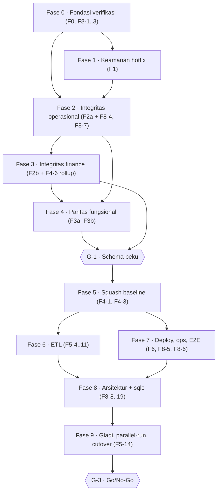
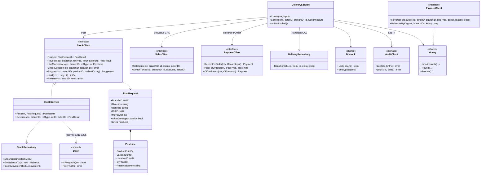
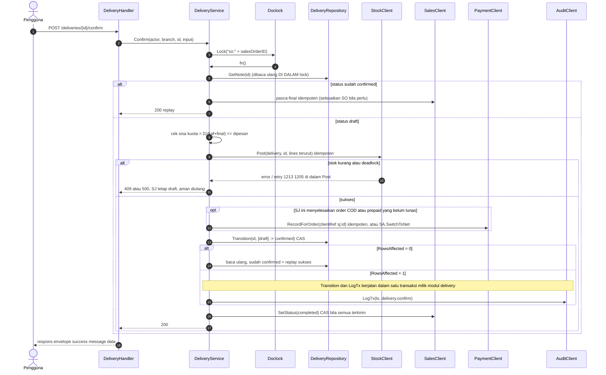
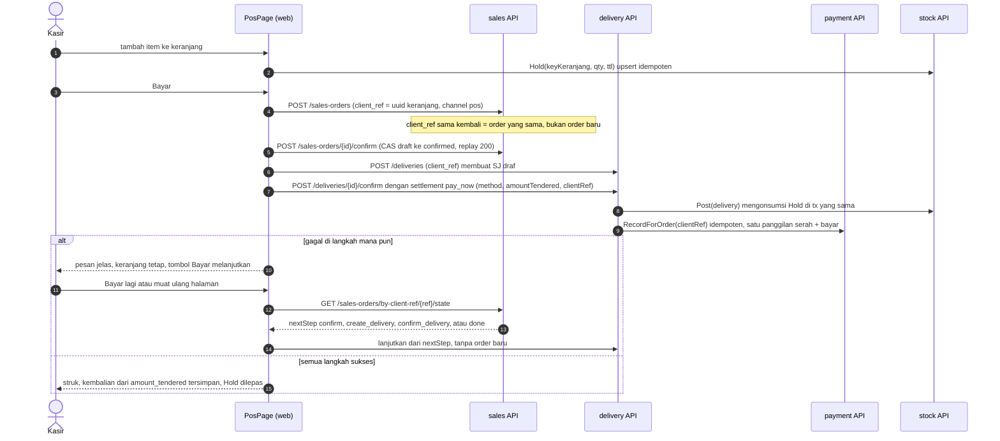

# PLAN — Revamp menggantikan aplikasi production

**Dibuat:** 2026-10-08 · **Jenis permintaan:** campuran *enhancement* (menutup bug dan gap pada modul yang sudah ada) dan *new capability* (tooling ETL/cutover, hardening deploy). Bukan greenfield.
**Sumber kebenaran angka:** audit independen 9 agen (2026-10-07/08) + 8 rancangan rinci di [design/](design/). Seluruh klaim di `docs/PARITY_AUDIT.md` diperlakukan sebagai belum terbukti; yang dipakai di sini adalah hasil pembacaan kode.

> **Susunan dokumen.** `PLAN.md` ini adalah satu-satunya rencana kerja: keputusan, scope, urutan, daftar tugas, diagram, kriteria selesai. Delapan berkas di `design/` adalah **lampiran rancangan per paket** (bukti `file:baris`, rancangan per fungsi, migrasi, skenario test). Daftar tugas di bawah merujuk ke ID tugas di lampiran itu. Bila ada selisih, `PLAN.md` menang untuk urutan dan keputusan; lampiran menang untuk detail teknis.

---

## 1. Tujuan dan kondisi awal

**Tujuan (dari pemilik):** revamp dinyatakan selesai bila memiliki fitur dan fungsi yang sama dengan aplikasi production (`H:\dimasprasetio\SAAS\mini-erp`), dengan arsitektur lebih baik, tanpa redundancy, performa baik, dan **schema yang lebih efisien tanpa mengubah cara pakai atau kelengkapan fitur**. Akhirnya revamp menggantikan production.

**Kondisi awal terverifikasi (2026-10-08):**

| Aspek | Kondisi |
|---|---|
| Build/test | `go build`, `go vet`, unit Go, test integrasi (15 berkas, MySQL nyata; seluruh `go test ./...` 3m29s di mesin ini), `tsc`, ESLint, arch-check, 86 test Vitest — **hijau** |
| Batas modul | bersih (0 impor non-contracts, 0 SQL/FK lintas modul) |
| Cakupan endpoint/halaman | tinggi: 217 endpoint, 65 halaman, 253/253 panggilan FE cocok router |
| Perilaku di balik endpoint | **ada gap uang/stok/keamanan** (§7 fase 1–3) |
| Artefak ETL | **0** — belum ada satu baris pun |
| sqlc | **0 file** query/hasil generate; 319 `database/sql` mentah (melanggar aturan proyek) |
| CI, E2E, runbook backup/rollback | **tidak ada** |

---

## 2. Keputusan terkunci pemilik (jangan dibuka ulang)

Setiap baris adalah jawaban nyata pemilik pada sesi ini.

| # | Keputusan | Jawaban pemilik |
|---|---|---|
| K-1 | Riwayat pembukuan di revamp | **Saldo awal per cabang + jurnal tahun berjalan** dimigrasi. Dokumen operasional sebelum tahun berjalan ditandai "sudah dijurnal oleh saldo awal" (tidak masuk antrean posting). |
| K-2 | Data legacy untuk ETL | Pemilik **menyediakan dump** di mesin ini (belum tersedia). ETL boleh dibangun dari definisi entity dulu; gladi menunggu dump. |
| K-3 | sqlc | **Migrasi bertahap ke sqlc, fase paling akhir.** |
| K-4 | Paritas yang dipulihkan | (a) jurnal otomatis selisih stok/opname/barang rusak; (b) harga jual manual per baris + harga minimum di SO; (c) termin prepaid + COD wajib lunas; (d) laporan keuangan gabungan lintas cabang. Ditambah semua gap fungsional lain, kecuali daftar by-design (§4.2). |
| K-5 | Schema | Efisiensi schema **tanpa mengubah penggunaan/kelengkapan fitur**. Database dev boleh **direbuild dari nol**; perubahan = migrasi tambahan selama pengembangan, di akhir fase schema di-**squash** jadi baseline bersih. |
| K-6 | Atomisitas dokumen lintas modul | **Idempotensi per dokumen + CAS status.** Tanpa UnitOfWork lintas modul, tanpa outbox. |
| K-7 | Checkout POS | **`client_ref` idempoten di `sales_orders`** + tiap langkah idempoten + reservasi stok aktif saat keranjang. Tanpa modul `pos` (ADR-0007 tetap). |
| K-8 | Upload | Sesi WhatsApp keluar dari folder yang disajikan; hanya subfolder `media/` yang dilayani; listing mati; URL lokal **bertanda tangan HMAC + expiry**. |
| K-9 | Pengecualian aturan #1 | **Disetujui:** `LineAmounts`/`Round`/`Prorate` di `shared/money` sebagai satu sumber kebenaran rumus pajak/diskon/prorata → **ADR-0010**. |
| K-10 | Pengecualian aturan #2 | **Disetujui, terbatas operasi uang/stok:** modul menulis audit **di dalam transaksinya** lewat `AuditClient.LogTx(tx, …)` → **ADR-0011**. Audit operasi lain tetap best-effort. |
| K-11 | Git | **Jangan commit dulu.** Tidak ada perubahan konfigurasi git. Pekerjaan berjalan di working tree; tiap fase ditutup dengan test hijau dan catatan perubahan di bagian "Jurnal pengerjaan" (§12). |

---

## 3. Keputusan analis (default; **dapat dibatalkan pemilik kapan saja**)

Pertanyaan terbuka dari delapan rancangan disaring. Yang punya rekomendasi kuat dan dampak terbatas diputuskan di sini sebagai *panggilan analis* (bukan keputusan pemilik). Pemilik cukup menyebut nomor bila ingin mengubahnya.

| # | Topik | Keputusan default | Alasan | Sumber |
|---|---|---|---|---|
| A-1 | Kode akun (COA) | **Ikut kode legacy**, tambah akun Uang Muka (2200/2300), Selisih Stok (5100), Pembulatan (5200), Selisih Retur Beli (5300); kunci mapping 13→18; `SetMapping` diberi guard | Akuntan terbiasa kode legacy; revamp belum produksi; ETL jadi peta identitas | F2b-8 |
| A-2 | Jurnal legacy PO/SO inklusif yang angkanya salah | Dibawa **apa adanya** + jurnal koreksi manual akuntan; ETL membuat laporan nilai per dokumen | Mengubah angka historis tanpa persetujuan akuntan berisiko; revamp sudah benar ke depan | F2b §2, F5-P2 |
| A-3 | `customer_credit` / kredit supplier | Dijurnal reklasifikasi Piutang→Uang Muka (paritas legacy) | K-4 paritas | F2b-1 |
| A-4 | Dokumen jatuh di periode tertutup belum terposting | "Posting susulan" ke periode terbuka, memo "Susulan", izin `finance.close.force` | Menghindari tutup buku macet | F2b-10 |
| A-5 | Definisi piutang/utang & penjualan di dashboard | **Persis legacy** (per order, min 0; penjualan = order selesai incl. PPN netto retur) | K-4 paritas; dashboard dibaca user tiap hari | F2b-13 |
| A-6 | `products.purchase_price` | Per **satuan beli**, dibagi faktor UOM (legacy) | Paritas; dasar member pricing BR-17 | F3b-5 |
| A-7 | Transfer antar-cabang | Tidak dijurnal (paritas legacy) | Paritas | F2b-3 |
| A-8 | Koreksi stok | **Selalu wajib approver** + mode strict (approver ≠ pemohon), seperti legacy | K-4 "semua gap fungsional"; kontrol internal | F3b-Q1, F2a-9 |
| A-9 | Ganti role aktif | Pulihkan paritas: **izin = role aktif**; menu Ganti Role hanya bila user punya >1 role | Least privilege; paritas | F3b-1, F3a-Q1 |
| A-10 | Login | Username **atau** email | Paritas | F3b-1 |
| A-11 | Kolom Harga Beli di daftar produk | Tampil untuk pemegang `products.view` (legacy) | Paritas | F3a-Q2 |
| A-12 | Menu "Tren & Stok" (reporting) | Dipertahankan; hapus hanya tipe FE ganda dan bagian yang tumpang tindih dengan finance | Murah, tidak memutus UI | F8-Q4 |
| A-13 | Endpoint `finance/costing/{sync,uncosted}` | Dipertahankan + UI kecil di panel kesiapan tutup buku | Dibutuhkan untuk HPP "menunggu data" | F8-Q5 |
| A-14 | Kwitansi | Samakan dengan legacy (tanpa tanda tangan, BR-30); terbilang dipertahankan bila ada di legacy | Paritas; cetak fisik diverifikasi pemilik (L3) | F3a-Q4 |
| A-15 | Pencarian pihak | Minimal 2 karakter, batas 1000 id (`PartyClient.SearchIDs`), tanpa snapshot `party_name` | Tanpa perubahan schema | F3a-Q5 |
| A-16 | Tipe produk | `bundle`→`paket`, `non_stock`→`non_stok` nilai terpisah | Keduanya ada di legacy; hanya label | F3b-Q4 |
| A-17 | Foto bukti SJ untuk channel POS | Wajib untuk SJ reguler, **dikecualikan** untuk channel `pos` | Serah di tempat; legacy tidak memakainya di `deliverGoods` | F2a-Q1 |
| A-18 | Nomor dokumen | Terima lubang nomor langka; alokasi dekat dengan insert; kunci bulan WIB | Tanpa tx lintas modul | F2a-Q2, F4-16 |
| A-19 | Tambah-bayar retur tukar | Ditagih saat serah pengganti (`pay_now`), kecuali pelanggan net → `charge` terbuka | Paritas legacy | F2a-Q3 |
| A-20 | PO yang seluruhnya diretur | **Tidak** otomatis dibatalkan (tetap `completed`) | Membatalkan order yang sudah dijurnal bertentangan dengan guard | F2a-Q4 |
| A-21 | Refresh token bersamaan | CAS + **grace 10 detik** (permintaan kedua mendapat sesi yang sama, tidak mencabut semua sesi) | Race antar-tab terbukti dari kode | F8-Q7, F1-10 |
| A-22 | Superadmin id 1 | Dipertahankan, tersembunyi, tidak bisa ditetapkan lewat API; akun seed berpassword default **dikunci** | Paritas + keamanan | F1-P1, F5 |
| A-23 | `role.manage` pada admin | Paritas (tanpa aturan anti-eskalasi) + dicatat sebagai risiko | Paritas | F1-P2 |
| A-24 | `INT UNSIGNED` untuk id | **Ya**; debit/credit **jangan** UNSIGNED | −24% ukuran DB (EST); probe membuktikan pengurangan UNSIGNED error | F4-3 |
| A-25 | Isolation DB | `READ COMMITTED` + `time_zone` UTC + retry deadlock | Terverifikasi di driver 1.9.3/MySQL 8.4.3 | F4-12 |
| A-26 | Retensi | audit 24 bln (arsip CSV sebelum hapus), sesi kedaluwarsa 30 hr, reservasi non-aktif 7 hr, jejak bot 90 hr; total audit eksak | Konservatif, dapat diatur | F4-Q2 |
| A-27 | `finance_tax_report_snapshots` | Dipertahankan + tambah pembaca | Paritas "beku laporan pajak" | F4-Q4 |
| A-28 | Ekspor PDF | Batas 10.000 baris dengan pesan galat jelas; XLSX streaming tanpa batas | Memori | F4-Q5 |
| A-29 | Baseline schema | **Satu berkas per modul** (18 berkas) | sqlc menegakkan batas modul | F8-Q8, F4-1 |
| A-30 | `UTC_TIMESTAMP(6)` | Diganti jam aplikasi (`timeutil.NowUTC`) saat migrasi sqlc | sqlc menolak fungsi itu; satu instans | F8-Q9 |
| A-31 | Koreksi fiskal legacy | Arsip + input ulang manual | Jumlah kecil, risiko mapping | F5-P6 |
| A-32 | Cakupan test | Ambang awal 65% `application` modul uang, 70% auth, 40% lainnya, dengan ratchet | Realistis | F8-6 |
| A-33 | CI | Berkas GitHub Actions dengan service MySQL 8.4 ditulis, **tidak dijalankan/di-push** oleh saya; build image saja | K-11, belum ada persetujuan runner | F1/F0-4 |
| A-34 | Tanggal saldo awal | Awal tahun berjalan (**2026-01-01**), dikonfirmasi saat gladi | Selaras K-1 | F5-P1 |

---

## 4. Scope

### 4.1 Dalam scope
Delapan paket, tiap paket punya lampiran rancangan:

| Paket | Isi | Lampiran |
|---|---|---|
| **F0** Fondasi verifikasi | MySQL test, guard nama DB, perintah `verify`, CI | [F0F1F6](design/F0F1F6-foundation-security-ops.md) |
| **F1** Keamanan & konfigurasi | upload, APP_ENV, proxy, sesi, sandi, seed role, S3, refresh | idem |
| **F2a** Integritas operasional | stok idempoten, retur, SJ, GR, transfer, cancel, POS backend, nomor dokumen | [F2a](design/F2a-ops-integrity.md) |
| **F2b** Integritas finance | COA, mapping, posting, reverse, HPP, laporan, dashboard, antrean | [F2b](design/F2b-finance-integrity.md) |
| **F3a** Paritas layar operasional | filter, detail order, pemilih, cetak, POS UI, harga manual | [F3a](design/F3a-parity-operational-screens.md) |
| **F3b** Paritas platform & master data | auth/RBAC, produk, impor, party, branch, company, audit, assistant | [F3b](design/F3b-parity-platform-masterdata.md) |
| **F4** Schema & performa | squash, pelebaran, tipe, indeks, rollup, N+1, ekspor, retensi | [F4](design/F4-schema-performance.md) |
| **F5** ETL & cutover | `tools/legacy-migration`, gladi, parallel-run, rollback | [F5](design/F5-etl-cutover.md) |
| **F6** Deploy & ops | Docker, compose, nginx, health, log, backup | [F0F1F6](design/F0F1F6-foundation-security-ops.md) |
| **F8** Arsitektur, sqlc, test | rumus tunggal, helper, wiring, arch-check, sqlc, E2E | [F8](design/F8-architecture-sqlc-tests.md) |

### 4.2 Di luar scope (by-design / bukan tugas saya)
- Knowledge base/RAG, multi-tenant (`companyId`), feature flags perusahaan, status order konfigurable + riwayat status, localization selain id-ID/IDR/WIB, PWA, `daily_operational_metrics`.
- Skala lebih dari **satu instance** (`doclock` dan cache in-process hanya sah untuk satu container; dicatat di ADR).
- **Verifikasi cetak fisik (L3)** di dot-matrix dan UAT per role: tugas pemilik.
- Penyediaan: dump legacy, kunci S3 terpisah, domain/TLS, tujuan backup, keputusan akuntan — **input pemilik** (§10).
- Push, PR, dan commit (K-11).

### 4.3 Inventaris reuse (terverifikasi di lampiran)
Dipakai ulang, **tidak** dibangun baru: `doclock`; `finance/application/opening.go` (jurnal cutover); `Post()` idempoten + `Preview()` builder sama; antrean derived `queue.go`; `LabelsByIDs/NamesByIDs`; `LinesByEntryIDs`; `shared/pagination`; `useAsyncData`; komponen `async-search-select`, `PartySearchSelect`, `ProductSearchSelect` (sudah ada, belum dipakai); endpoint `Hold/Release/Consume` stok (sudah ada, belum dipanggil web); `scripts/arch-check.mjs`; `shared/money` (ada, belum diimpor siapa pun); harness `internal/integration`. Tiap "create new" di lampiran disertai bukti celah.

---

## 5. Prinsip desain lintas fase

1. **Idempotensi gerakan stok.** `StockClient.Post/Reverse` menggantikan `MoveIn/MoveOut`. Kunci unik `stock_movements(ref_type, ref_id, product_id, variant_id, location_id, direction)`; baris posisi sama dijumlahkan; panggilan ulang = no-op sukses. Kunci lock diurutkan; retry untuk 1213/1205.
2. **CAS status.** Setiap transisi `UPDATE … SET status=? WHERE id=? AND status IN (asal sah)` + cek `RowsAffected`; 0 baris → baca ulang: sudah target = replay sukses, selain itu `Conflict`.
3. **Baca ulang di dalam `doclock`.** Urutan kunci baku `sr:<id>` → `so:`/`po:<id>` → `party:<id>`. `doclock` menyerialkan satu proses; penjaga sebenarnya = (1)+(2).
4. **Confirm aman diulang.** Validasi tanpa efek samping → efek samping idempoten → CAS status (penanda final) → langkah pasca-final idempoten. Dokumen sudah final dipanggil ulang = jalankan langkah pasca-final lalu 200.
5. **Forward recovery, bukan kompensasi diam-diam.** Tidak ada `_ = …MoveIn(… "_rollback")`. Pembatalan terminal lewat `Reverse` (`<ref>_cancel`), juga idempoten. Tidak ada `_ =` di jalur uang/stok.
6. **Rumus sisa kuantitas satu.** `komitmen = Σ(draf + final)` per (induk, produk, varian) basis qty dasar + akumulasi baris request; dicek di Create **dan** Confirm di dalam lock.
7. **Rumus uang satu.** `shared/money.LineAmounts/Round/Prorate` (ADR-0010) dipakai sales, purchasing, finance, kedua retur.
8. **Audit uang tidak hilang.** `AuditClient.LogTx` untuk daftar operasi uang/stok tertulis (ADR-0011).
9. **Rollup dapat dibangun ulang.** Saldo ter-rollup (akun/pihak/produk per hari, posisi biaya) selalu dapat dibangun ulang dari `finance_journal_lines`; `VerifyRollups` di gerbang tutup periode.
10. **Migrasi additive selama pengembangan,** lalu squash (§6, G-2). Nomor migrasi di lampiran sementara; yang mengikat adalah urutan dependensi.

---

## 6. Urutan fase dan gerbang

**Gerbang:**
- **G-0 (setelah Fase 0):** MySQL test hidup, guard DB `*_test` aktif, `go test ./...` + `verify` hijau di mesin ini.
- **G-1 Schema beku:** semua migrasi tambahan fase 1–4 selesai, F4-17 (harness EXPLAIN/benchmark) hijau, `verify` hijau → tag lokal `schema-freeze` **dicatat di §12** (bukan tag git, karena K-11).
- **G-2 Squash terbukti:** F4-1 tahap 1 (diff `information_schema` = nol) dan tahap 2 (diff = manifest).
- **G-3 Go/No-Go:** §9.

Paralelisme yang aman: F5-1, F5-2, F5-3, F5-12, fixture `legacy_mini.sql` (F5-13) dan kerangka F8-1..3 boleh mulai sebelum squash.

---

## 7. Daftar tugas (urut kerja)

Format: `- [ ] ID — judul (ukuran)` → rincian di lampiran. **Kriteria selesai** tiap fase ada di akhir blok.

### Fase 0 — Fondasi verifikasi  *(lampiran F0F1F6, F8)*
- [x] **F0-1** Nyalakan MySQL Laragon untuk test + `mini_erp_test`, user MySQL terbatas (S) — selesai (`scripts/test-db.mjs`, user terbatas `mini_erp_test`)
- [x] **F0-2** Pengaman `integration_test.go`: nama DB harus berakhiran `_test` (M) — selesai (`internal/testutil/dsnguard`)
- [x] **F0-3** Perintah `verify` yang jalan di mesin ini, tanpa mengubah konfigurasi git (`-buildvcs=false`) (S) — selesai (`scripts/verify.mjs`)
- [x] **F0-4** Berkas CI GitHub Actions (tidak dijalankan) (M) — selesai (`.github/workflows/ci.yml`, belum dijalankan)
- [x] **F8-1** `internal/bootstrap` wiring bersama main.go + test; fixture; ukur baseline (M) — `bootstrap.Wire` dipakai server dan harness integrasi; baseline `go test ./...` = 490 dtk (§12)
- [x] **F8-2** Test rute + guard permission otomatis dari daftar rute (M) — selesai: `TestRouteGuards` (230 rute: 401 tanpa token, 403 tanpa izin, 403 tanpa cabang) + `TestRouteTableMatchesMain`
- [x] **F8-3** Kontrak FE↔router otomatis (`scripts/contract-check.mjs`) (S) — selesai: `scripts/contract-check.mjs` memeriksa rute dan kode izin

**Selesai bila:** G-0 tercapai; baseline waktu dicatat di §12.

### Fase 1 — Keamanan & konfigurasi  *(F0F1F6)*
- [x] **F1-1** Upload: sesi WA ke `_private`, hanya `media/` disajikan, URL HMAC+exp, listing mati (L) — **hotfix pertama**
- [x] **F1-9** Pisahkan S3 (prefix/kunci), `media_files.origin`, Archive tidak menghapus objek bersama (M)
- [x] **F1-2** `APP_ENV` wajib; default tidak melonggarkan validasi secret (S) — selesai 2026-10-08, lihat §12
- [x] **F1-3** Trusted proxy untuk IP klien + rate limit login (M)
- [x] **F1-5** Kebijakan sandi: batas 72 byte, cost 12, rehash saat login, anti-timing (S)
- [x] **F1-4** Pencabutan sesi: nonaktif, ganti sandi, reaktivasi, Refresh cek status (M)
- [x] **F1-10** Refresh token: CAS + grace 10 dtk (`user_sessions.rotated_at`) (M)
- [x] **F1-6** Seed katalog permission + role default idempoten saat start; tanpa password hardcode (L)
- [x] **F1-7** Proteksi role sistem, admin terakhir, kebijakan role reserved (M)
- [x] **F1-8** Approver koreksi stok: rate limit + bcrypt di luar transaksi (S)
- [x] **F1-11** Audit untuk assistant/WhatsApp (S)

**Selesai bila:** `GET /uploads/whatsapp_session.db` dan listing → 404 (test); user nonaktif tidak bisa refresh (test); DB kosong + start server menghasilkan katalog izin + role (test).

### Fase 2 — Integritas operasional uang & stok  *(F2a, F8-4, F8-7)*
Urutan F2a §4.1 (tiap baris satu unit kerja yang bisa diverifikasi sendiri):
- [x] **F2a-11** Nomor dokumen: kunci bulan WIB (S) — selesai 2026-10-09 (§12)
- [x] **F8-7** `shared/money`: `LineAmounts/Round/Prorate` satu sumber + ADR-0010 + test properti 1 juta kasus melawan salinan lama sebagai oracle, dijaga juga oleh test integrasi `money_paths` yang sudah ada (M) — *sebelum* builder finance/retur disentuh
- [x] **F4-9** Audit: indeks `audit_logs`, tabel `audit_log_details`, kolom `actor_type` (M) — dikerjakan **di sini**, prasyarat `LogTx`
- [x] **ADR-0011 + `AuditClient.LogTx`** kontrak audit dalam transaksi modul pemanggil, terbatas operasi uang/stok (M; rancangan di F3b-8) — *dibuat sebelum dipakai* oleh tugas F2a di bawah
- [x] **F2a-0** Fondasi stok `Post/Reverse` idempoten, kunci unik, urutan kunci, retry deadlock (`dberr.RetryTx`) (L) — selesai 2026-10-09 (§12)
- [~] **F2a-4** Matriks pemulihan saga + harness injeksi-gagal, `doclock.SetBypass` untuk test (M) — harness `SetBypass`, tes pemulihan per alur dan laporan konsistensi `GET /ops/integrity` (SJ draf dengan stok keluar, GR pending, retur tak sinkron) selesai; dekorator `faultyStock` tidak dibuat (kegagalan di tengah alur disimulasikan langsung lewat `Post` + status SQL) (§12)
- [~] **F8-4** Test integrasi wajib untuk uang, konkurensi, retry, sesi (T-01…) ditulis **bersama** tiap tugas F2a (L, berjalan) — tes uang, konkurensi, retry, sesi ada untuk semua alur Fase 2–3 (±400 tes integrasi); daftar T-xx penuh belum dipetakan satu per satu
- [x] **F2a-2** Surat jalan: kuota, lock, Confirm aman-ulang, dokumen wajib (L) — selesai 2026-10-09: kuota, lock, replay, CAS, `client_ref`, alokasi otomatis lintas lokasi, konsumsi reservasi, dokumen wajib (sopir/petugas/penerima/foto) kecuali POS dan pengganti, bisa dimatikan lewat setting `delivery_require_evidence` (§12)
- [x] **F2a-3** Penerimaan barang: status pending/posted, duplikat, nomor, termin (M) — selesai: status pending/posted, duplikat, nomor, termin prabayar/COD + settlement pada penerimaan terakhir (§12)
- [x] **F2a-1** Retur jual & beli: sisa, akumulasi, cek ulang, CAS (M) — selesai; `SetReplacementStatus` kini CAS (§12)
- [x] **F2a-5** Transfer stok: CAS, atomik, tujuan per item, urutan kunci (M) — selesai: tujuan per baris (`stock_transfer_items.to_location_id`); UI menunggu F3a (§12)
- [x] **F2a-9a** Lokasi `kind`, induk berstok ditolak, lokasi RUSAK dikecualikan dari ketersediaan (M) — selesai 2026-10-09 (§12); UI konfirmasi `forceTransfer` menunggu F3a
- [x] **F2a-7** Barang non-stok/jasa (S) — selesai kecuali jurnal finance untuk baris jasa (F2b) (§12)
- [x] **F2a-6** Guard pembatalan, pembayaran idempoten (`client_ref`), pasangan offset (`pair_id`), FIFO due-date, metode `check`, izin refund (L) — selesai; izin refund granular dan refund lewat modul payment kini memeriksa `salesreturn.refund`/`purchasereturn.refund`
- [x] **F2a-10** Sales/purchasing: harga manual & minimum, termin prepaid/COD/net, snapshot, ubah-setelah-konfirmasi, tampilan bayar (L) — selesai: termasuk settlement COD di penerimaan PO, ubah order terkonfirmasi (ekonomi hanya bila tanpa dependen, header selalu), `paidAmount/outstandingAmount/paymentStatus/effectiveDueDate/isOverdue` di daftar dan detail, `payment_term_days` PO (§12)
- [x] **F2a-8** Retur lanjutan: kondisi, tukar (selisih), refund, offset otomatis (L) — selesai 2026-10-09 (§12)
- [x] **F2a-12** POS backend: `client_ref`, resume, reservasi, alokasi lintas lokasi, tunai diterima, antrean yatim (L) — selesai 2026-10-09: `client_ref` order dan SJ, `GET /sales-orders/by-client-ref/{ref}/state`, `Hold` upsert + `Release` per cabang + penyapu 60 dtk, izin `stock.reserve`, konsumsi reservasi di SJ, antrean POS yatim (§12)
- *(F2a-9b — koreksi/rusak/scan/opening/daftar saldo — butuh kontrak finance `OpeningPosted`/`AverageUnitCost`/`PeriodLockedThrough`; dikerjakan di Fase 3 setelah F2b-11 dan F2b-10.)*

**Selesai bila:** semua skenario konkurensi lulus (dua klik bersamaan, retry setelah gagal di tengah, dua draf retur penuh → tepat satu yang bisa dikonfirmasi, stok tidak pernah keluar/masuk dua kali); tidak ada `_ =` pada jalur uang/stok (`grep` + arch-check).

### Fase 3 — Integritas finance  *(F2b + F4-6, F4-12, F4-13)*
Urutan F2b §1.4:
- [x] **F2b-8** COA: peta kode legacy→revamp, akun baru, kunci mapping 18 (M) — selesai (§12)
- [x] **F2b-7** Mapping akun benar-benar dipakai + guard perubahan (M) — selesai: `BalancesByKey` dipakai dasbor (§12)
- [x] **F4-12** DSN: `READ COMMITTED`, UTC, timeout, pool (S) — selesai (parameter koneksi diuji per koneksi)
- [x] **F4-13** Race cache chart-of-accounts & sesi (S) — selesai (generasi + TTL cache akun; `mark/putIf` cache sesi)
- [x] **F2b-4** Reverse menyalin dimensi; repost setelah reverse (kolom `source_active`); `scope` fiskal/komersial (L) — selesai (§12)
- [x] **F2b-6** Guard status dokumen pada Post/Preview (S) — selesai (§12)
- [x] **F2b-5** Cancel dokumen setelah posting → jurnal dibalik (M) — selesai (§12)
- [x] **F2b-14a + F4-6** Posisi biaya, kursor, rollup saldo akun/pihak/produk harian + indeks (L) — selesai dengan satu perbedaan sadar: posisi biaya dibaca per kunci (indeks `(branch,product,variant)`), bukan tabel posisi persisten; rollup harian `finance_account_daily` + `VerifyRollups`/`RebuildRollups` + `GET /finance/integrity`; kursor biaya toleran celah (§12)
- [~] **F2b-11** HPP: tahan "menunggu data", biaya saldo awal eksplisit, muat ledger HPP untuk ETL (L) — rantai biaya + blokir biaya kosong + saldo awal berbiaya + biaya ÷ faktor UOM selesai; sisa: halaman "biaya belum lengkap" (UI) dan impor stok awal berbiaya (F2a-9b) (§12)
- [x] **F2b-3** Jurnal otomatis selisih stok/opname/rusak (M) — K-4(a) — selesai (§12)
- [x] **F2b-1** Pemetaan akun per jenis alokasi pembayaran (M) — selesai; izin refund granular di F3b-2 (§12)
- [x] **F2b-2** Retur tukar: jurnal penjualan pengganti (M) — selesai (§12)
- [x] **F2b-9** Hapus batas diam-diam 10.000/200/5000 (L) — selesai: antrean eksak, GL berjendela (window SQL) + paginasi, PPN agregasi SQL, `ListStockedAfter`, retur per order tanpa `ListByBranch` (§12)
- [x] **F2b-10** Antrean/Readiness vs migrasi: `finance_cutover`, kursor, gate tutup periode (L) — selesai: izin `finance.close.force`, hitungan faktur per bulan, posting susulan (`action: catchup`, memo "Susulan") (§12)
- [x] **F2a-9b** Koreksi stok (approver selalu), rusak, scan (`ResolveScan`), opening guard, **daftar saldo** (L) — selesai: approver selalu (setting `stock_adjust_always_approve` default aktif, mode strict `stock_adjust_approval_mode`), basis biaya, alasan rusak wajib, `ResolveScan`, guard opening + harga beli + duplikat/riwayat di preview, daftar saldo (cari, kritis, lokasi, rusak) (§12)
- [x] **F2b-12** Laporan: neraca saldo kumulatif, kas saldo awal/akhir, aging, **gabungan lintas cabang**, PPN, biaya usaha, pembulatan, izin finance granular (L) — selesai: neraca saldo kumulatif, laporan kas (awal/masuk/keluar/akhir), aging per dokumen, semua cabang (`branch=all`, izin `finance.report.all_branches`), rincian PPN (jual/retur/beli), GL berurut, biaya usaha atomik + alasan batal + filter, nomor jurnal dalam transaksi, sisa pembulatan prorata, izin finance granular (§12)
- [x] **F2b-13** Dashboard & reporting paritas (L) — selesai: penjualan dari order selesai (PPN, nett retur) tanpa posting, piutang/utang per order min 0, prioritas berskor SQL, terlaris dari order selesai nett retur, penanda biaya tak lengkap, hitungan widget, `reporting/orders` dan `reporting/stock` (§12)
- [x] **F2b-15** Paket pajak plafon (S–M) — selesai: pembalikan jurnal diatribusikan ke dokumen asal (N10) (§12)

**Selesai bila:** untuk tiap sumber dokumen ada test integrasi yang memeriksa **debit=kredit, saldo sub-ledger = saldo buku, dan laporan piutang/utang bersih** (khususnya refund, offset, tukar, selisih stok); `VerifyRollups` hijau; tidak ada pemotongan data diam-diam.

### Fase 4 — Paritas fungsional  *(F3a, F3b)*
F3a (urutan lampiran): P1 `shared/listquery`, P2 `PartyClient.SearchIDs`, P3 `UserClient.NamesByIDs`, lalu
- [x] **F3a-12** Cek otomatis kontrak FE↔router dan izin (S) — selesai 2026-10-10 (§12)
- [x] **F3a-1** Daftar order: filter lengkap, `partyName`, ekspor ikut filter (M) — selesai 2026-10-10 (§12)
- [~] **F3a-5** Filter/pencarian daftar lain (M) — filter pembayaran, SJ, retur, transfer selesai; filter penerimaan barang dan mutasi stok hanya yang didukung handler (§12)
- [x] **F3a-3** Pemilih async server-side (hapus daftar 50 baris) (M) — selesai 2026-10-10 (§12)
- [x] **F3a-2** Detail order terpadu: rincian tagihan, riwayat, aksi dari dalam order (L) — selesai 2026-10-10 (§12)
- [x] **F3a-6** Cetak: profil cetak untuk semua peran, isi nota, verifikasi layout (M) — selesai: profil cetak lewat `GET /company/print-profile`, nota/kwitansi/struk; layout fisik diverifikasi pemilik
- [x] **F3a-7** UX: 404, sesi habis tanpa buang state, izin dashboard/POS (M) — selesai 2026-10-10 (§12)
- [x] **F3a-9** Harga manual per baris + klem harga minimum + termin (UI) (L) — K-4(b)(c) — selesai 2026-10-10 (§12)
- [x] **F3a-4** Daftar saldo stok semua barang (UI) (M) — selesai 2026-10-10 (§12)
- [x] **F3a-8** POS frontend idempoten + reservasi + UX checkout (L) — selesai 2026-10-10 (§12)
- [~] **F3a-10** UI costing, switch-role, peleburan laporan (M) — UI "biaya belum lengkap", ganti role dan laporan operasional selesai; peleburan reporting↔finance hanya di sisi dasbor
- [x] **F3a-11** Komponen retur kembar → parametris (M) — selesai 2026-10-10 (§12)

F3b (urutan lampiran):
- [x] **F3b-2 (rute)** `proof` tanpa branchGuard, ekspor, refund, `member_types.view` → `TestRouteGuards` (S) — selesai 2026-10-10 (§12)
- [x] **F3b-1** Login username/email, izin = role aktif, UI ganti role, jejak login (M) — selesai 2026-10-10 (§12)
- [x] **F3b-3.1–3.3** Wiring `StockCheck`, scan `ResolveScanCode`, tabrakan kode produk/varian (M) — **bug harian POS** — selesai 2026-10-10 (§12)
- [x] **F3b-5** Member pricing (konversi UOM, error per baris, batch) + atribut party (M) — selesai 2026-10-10 (§12)
- [~] **F3b-3.4–3.6 + F3b-6** Kolom/tipe/status produk, media resize, branch (M) — tipe/status/kolom/media selesai; keluaran media JPEG/PNG (tanpa WebP, tanpa cgo)
- [~] **F3b-4** Impor produk: 4 sheet, alias header ID, `.xlsx/.xls`, upsert, parser angka longgar (L) — impor 4 sheet, alias, upsert, parser angka, gerbang semua-atau-tidak selesai; `.xls` ditolak dengan pesan "Simpan sebagai .xlsx" (parser OLE2 tak dipasang: tak ada fixture dan sumber tak terawat)
- [x] **F3b-2 (katalog)** Granularitas izin finance/stok + role reserved (L) — selesai 2026-10-10 (§12)
- [x] **F3b-8** Audit: before/after, lintas cabang, tidak ditelan, retensi (L) — before/after, lintas cabang, retensi, dan ADR-0011 (audit dalam transaksi) untuk uang/stok/finance/user/company; alur non-uang tetap best-effort sesuai ADR
- [x] **F3b-9** Assistant/WhatsApp paritas intent + audit (M) — selesai 2026-10-10 (§12)
- [x] **F3b-7** Company: setting berpengaruh (`stockAdjustmentApprovalMode`) (S) — selesai 2026-10-10 (§12)

**Selesai bila:** matriks paritas fitur (lampiran F3a/F3b + `PARITY_AUDIT.md` yang dikoreksi) tidak punya baris P0/P1 terbuka; `contract-check` 100%.

### Fase 4b — Schema & performa lanjutan  *(F4, berjalan menyatu dengan Fase 2–4)*
Tugas F4 **disisipkan bersama paket pemiliknya**, tidak menunggu akhir: F4-4 bersama F2a-0; F4-8 bersama F2a-6; F4-5 **sebelum** filter F3a-1/F3a-5 memakainya (indeks dulu, filter kemudian); F4-9 **sebelum** `AuditClient.LogTx` (Fase 2) dan F3b-8 (tabel `audit_log_details`); F4-6 bersama F2b-14a; F4-7 bersama tugas yang menyentuh jalur yang sama; F4-2 per modul saat modul itu disentuh.
- [x] **F4-2** Pelebaran kolom agar data legacy muat (M) — migrasi 000050–000072 + tes panjang maksimum
- [x] **F4-4** Stok: indeks, kolom, retensi, daftar mutasi (M) · **F4-5** SO/PO: indeks daftar, `client_ref`, `ListByParty` (M) — F4-4/F4-5 indeks dan daftar selesai; `ListByParty` tidak dibatasi (menyentuh FIFO uang)
- [~] **F4-7** N+1 jalur baca & tulis (`TaxDetail`, `payment.Ledger`, `priceLines`, `MoveOut`) (M) · **F4-8** indeks payment/delivery/retur/GR + `WaitingReturn` sargable (S) — N+1 utama selesai dengan penghitung statement per request; sisa `GetByID` per baris di retur/SJ pengganti dan assistant; F4-8 selesai
- [x] **F4-9** *(sudah dikerjakan di Fase 2; sisa: job retensi audit)* · **F4-10** Housekeeping/retensi (S) — F4-9/F4-10 selesai: retensi dari company settings (`retention.*`), penyapu harian
- [x] **F4-11** Ekspor SO/PO: keyset + streaming + timeout per rute (M) · **F4-14** Dashboard 7 request (M) · **F4-15** `CriticalStock` tanpa batas 5000 (S) · **F4-16** Penomoran 1 statement (S) — F4-11, F4-15, F4-16 selesai; F4-14 dilewati dengan alasan terukur (18 statement, ±12 ms)
- [x] **F4-17** Harness EXPLAIN/benchmark + verifikasi rollup (M) — **wajib hijau sebelum G-1** — harness EXPLAIN (25 bentuk query) + penghitung statement; `scripts/schema-compare.mjs`

### Fase 5 — Squash  *(F4-1, F4-3; setelah G-1)*
- [x] **F4-1** Baseline per modul (18 berkas) + pembanding `information_schema` tahap 1 (diff = 0) (L) — selesai 2026-10-11: 18 berkas baseline `000001_user … 000018_assistant` (63 tabel) dibangkitkan `scripts/squash-baseline.mjs`; `schema-compare` sebelum/sesudah = identik; migrasi berikutnya mulai `000019`
- [~] **F4-3** Tipe & ukuran baris (INT UNSIGNED, PK komposit, CHECK, `entry_date DATE`, charset) = tahap 2, diff = manifest (M) — DITUNDA dengan sadar: tidak ada ukuran yang menuntut (volume 3 jt baris jurnal muat), permukaan regresi besar (`entry_date`, tipe id); dapat dilakukan kelak sebagai migrasi tambahan dibuktikan `schema-compare --expected`
- [x] Hapus migrasi lama; rebuild DB dev; jalankan seluruh suite — selesai; DB test dibangun ulang dari baseline (`TESTDB_REBUILD`), seluruh suite hijau; DB dev berdata harus dibuat ulang (lihat `knowledge/BACKEND_GUIDE.md`)

**Selesai bila:** G-2.

### Fase 6 — ETL  *(F5; setelah G-2, kecuali F5-1/2/3/12/13-fixture)*
- [~] **F5-1** Kerangka modul, konfigurasi, penjaga keamanan (S) · **F5-2** Preflight + ±45 SQL pemeriksa fakta (M) · **F5-3** Extract streaming → JSONL (M) — alat ETL (`cmd/etl`, `internal/etl/*`) selesai dan diuji pada fixture; dump nyata belum dijalankan (di luar development)
- [~] **F5-4** Transform master & uang (MoneyRounder, enum, status) (M) · **F5-5** Transform dokumen transaksi (L) · **F5-6** Transform stok & ledger HPP (L) · **F5-7** Transform keuangan: COA, saldo awal, jurnal tahun berjalan, penanda posting (L) — termasuk retur, saldo awal, jurnal tahun berjalan, penanda posting
- [~] **F5-8** Load, IDMap, idempotensi (M) · **F5-9** Lampiran/berkas ke `media/` (M) · **F5-10** SequenceRebuilder (S) · **F5-11** Verify/rekonsiliasi (L) · **F5-12** Arsip data tak termigrasi & keamanan akun (S) · **F5-13** Rangkaian test ETL (L) — termasuk verifikasi ±40 pemeriksaan, `verify --self-test`, `rehearse`, `daily-verify`, `export-since`

**Selesai bila:** ETL dijalankan dua kali pada DB kosong dengan fixture → rekonsiliasi bersih dan idempoten; rekonsiliasi mendeteksi baris yang sengaja dirusak. (Dengan dump nyata: lihat Fase 9.)

### Fase 7 — Deploy, operasional, E2E  *(F6, F8-5/6/17)*
- [x] **F6-5** Observability: request-id, konteks log, stack panic, metrics (M) · **F6-4** Health/readiness, timeout HTTP, pool (M) · **F6-6** Graceful shutdown + konteks gateway WA (M) · **F8-17** siklus hidup goroutine (S) — request-id, stack panic, metrics, `/healthz` `/readyz`, timeout HTTP, shutdown anggun (WhatsApp pairing perlu uji dengan ponsel)
- [ ] **F6-1** Dockerfile reproducible (Go 1.26, `npm ci`, ca-certificates, non-root, healthcheck) (M) · **F6-2** compose + nginx (M) · **F6-3** migrasi langkah deploy eksplisit (S) · **F6-7** backup/restore/rollback + runbook (M) · **F6-8** dokumen + `.env.production.example`, koreksi dokumen (S)
- [~] **F8-5** E2E Playwright 10 spec (DB `mini_erp_e2e`) (L) · **F8-6** target cakupan + definisi "cukup untuk cutover" (S) — F8-5 selesai: `apps/e2e` 10 spec (44 lulus, 2 `fixme` yang sudah diperbaiki di backend) pada `mini_erp_test` dengan kunci DB; F8-6 target cakupan belum diukur

### Fase 8 — Arsitektur & sqlc  *(F8)*
- [x] **F8-8** helper kecil bersama (M) · **F8-9** envelope/parse limit/dokumen paginasi (S) · **F8-10** ADR: modul kembar tidak dijadikan mesin generik (S) · **F8-11** reporting vs finance inventory-value (S) · **F8-12** kode mati & endpoint tak terpakai (S) · **F8-13** hapus setter, verifikasi wiring (M) · **F8-14** ADR pola transaksi (M) — selesai 2026-10-11: `shared/dbutil`, `auth/contracts` (ActorID/BranchID/Guard), `shared/response`, `pagination.ParseDisplayLimit`; F8-10 ADR-0013, F8-11 alias, F8-12 kode mati, F8-13 `Modules.Verify()` + `AuthzHub` (setter tersisa = siklus konstruksi nyata), F8-14 ADR-0014 (§12)
- [x] **F8-15** arch-check diperkuat + self-test (kepemilikan tabel SQL, FK lintas modul, siklus, sqlc nyata) (M) · **F8-16** koreksi dokumen + ADR-0010/0011/0012 (S) — selesai: `scripts/arch-check/` dengan 13 aturan + `--self-test` 41 kasus, `scripts/sqlc-migration-status.json`, `scripts/arch-allow.json` (33 temuan bernalar); F8-16 koreksi dokumen + ADR-0012..0016 selesai
- [ ] **F8-18** Migrasi sqlc bertahap per modul, urut dari `media` ke `finance`, SQL tulisan tangan hanya lewat ADR-0012 (L, ±35–40 hari-kerja dengan test karakterisasi)
- [ ] **F8-19** DTO respons bertipe (opsional, tidak diprioritaskan)

**Selesai bila:** `grep` `QueryContext` mentah di luar whitelist = 0; arch-check Rule C memeriksa berkas sqlc nyata. *(Fase ini dapat dihentikan tanpa menghalangi cutover; ketentuan di §11.)*

### Fase 9 — Gladi, parallel-run, cutover  *(F5-14)*
- [ ] Gladi L1 dan L2 dari DB kosong dengan dump nyata → K10 nol selisih
- [ ] Verifikasi cetak fisik L3 (5 dokumen) oleh pemilik; UAT per role
- [ ] Parallel-run 1–2 minggu (legacy tetap catatan sah, rekonsiliasi harian stok/piutang/kas) atau cutover langsung sesuai keputusan pemilik
- [ ] Freeze legacy → ETL final → SequenceRebuilder → smoke test → buka akses; komunikasi login ulang
- [ ] Rollback: legacy read-only sebagai jalur balik selama jendela yang disepakati

---

## 8. Diagram

### 8.1 Class diagram — inti perubahan atomisitas (kontrak dan pemanggil)

### 8.2 ERD — tabel baru/berubah paling penting (relasi lintas modul = ID primitif, tanpa FK)

```mermaid
erDiagram
    stock_movements {
        bigint id PK
        bigint branch_id
        bigint product_id
        bigint variant_id
        bigint location_id
        string direction "in atau out"
        string ref_type
        bigint ref_id
        decimal qty_base
        decimal balance_before "baru"
        decimal balance_after "baru"
        datetime moved_at "baru"
        decimal unit_cost "baru"
    }
    stock_reservations {
        bigint id PK
        string reservation_key UK
        string status
        datetime expires_at
    }
    stock_adjustments {
        bigint id PK
        bigint branch_id
        string kind
        bigint approved_by
        string approval_mode
    }
    sales_orders {
        bigint id PK
        string number UK
        string client_ref "baru, unik per cabang"
        datetime order_date "datetime, bukan date"
    }
    sales_order_items {
        bigint id PK
        bigint order_id
        string pricing_source "baru: standard member_rule manual"
        bigint base_price "baru"
        boolean stock_tracked "baru"
    }
    delivery_notes {
        bigint id PK
        string number UK
        string client_ref "baru"
        string status "CAS"
    }
    payments {
        bigint id PK
        string client_ref "baru"
        bigint pair_id "baru, pasangan offset"
        bigint amount_tendered "baru"
        string method "cash transfer offset check"
    }
    finance_journal_entries {
        bigint id PK
        string source_doc_type
        bigint source_doc_id
        tinyint scope "0 komersial 1 fiskal"
        tinyint source_active "virtual, unik 4 kolom"
        string status
    }
    finance_journal_lines {
        bigint id PK
        bigint entry_id
        bigint account_id
        bigint party_id
        bigint product_id
        bigint debit
        bigint credit
    }
    finance_account_daily {
        bigint branch_id PK
        tinyint scope PK
        bigint account_id PK
        date day PK
        bigint debit
        bigint credit
    }
    finance_party_daily {
        bigint branch_id PK
        bigint account_id PK
        bigint party_id PK
        date day PK
        bigint debit
        bigint credit
    }
    finance_cost_positions {
        bigint branch_id PK
        bigint product_id PK
        bigint variant_id PK
        decimal qty
        decimal total
    }
    finance_cost_state {
        bigint branch_id PK
        bigint last_movement_id
    }
    finance_cutover {
        bigint branch_id PK
        string doc_type PK
        bigint covered_through_id
    }
    audit_logs {
        bigint id PK
        bigint branch_id
        string action
    }
    audit_log_details {
        bigint log_id PK
        json before_json
        json after_json
        json metadata_json
    }
    media_files {
        bigint id PK
        string file_key UK
        string origin "app atau legacy"
    }
    finance_journal_entries ||--o{ finance_journal_lines : "entry_id"
    sales_orders ||--o{ sales_order_items : "order_id"
    audit_logs ||--o| audit_log_details : "log_id, FK cascade"
```

*Catatan:* hanya relasi **dalam satu modul** yang digambar. `sales_orders`, `delivery_notes`, `payments`, `stock_*` tidak berelasi FK dengan tabel modul lain; hubungan (`sales_order_id`, `party_id`, `product_id`) disimpan sebagai ID primitif sesuai aturan modular monolith. Tabel `finance_account_daily`, `finance_party_daily`, `finance_cost_positions` adalah **turunan** dari `finance_journal_lines`/`stock_movements` dan selalu dapat dibangun ulang (prinsip 9), jadi tidak digambar sebagai relasi. `stock_reservations` dikonsumsi di dalam `Post` lewat `reservation_key`, bukan lewat FK. Daftar kolom lengkap (68 tabel) ada di F4 Lampiran A.

### 8.3 Sequence — Konfirmasi surat jalan yang aman diulang

### 8.4 Sequence — Checkout POS dengan `client_ref`

---

## 9. Definisi selesai dan Go/No-Go (G-3)

Revamp **boleh menggantikan production** hanya bila semuanya terpenuhi dan dapat diverifikasi:

1. `verify` hijau di mesin bersih: `go build`, `go vet`, `go test ./...` (termasuk integrasi MySQL), `tsc`, lint, vitest, arch-check, `contract-check`.
2. Tidak ada temuan P0/P1 terbuka pada matriks paritas (lampiran F3a/F3b dan audit F2a/F2b) tanpa persetujuan tertulis pemilik.
3. Test konkurensi dan retry lulus untuk SJ, penerimaan, retur, transfer, pembayaran, dan POS.
4. **Rekonsiliasi ETL nol selisih** pada gladi L1 dan L2 dengan dump nyata: jumlah baris per entity, total order per cabang, saldo stok per produk/lokasi, piutang/hutang per pihak, kas/bank per akun, neraca saldo, jumlah dan total pembayaran, lampiran per pemilik, nilai persediaan sub-ledger = buku besar.
5. Jurnal tahun berjalan terbawa; laporan laba rugi/neraca tahun berjalan cocok dengan legacy (toleransi 0 setelah koreksi manual A-2 dicatat).
6. Docker image terbangun dari mesin bersih; `docker compose up` sehat; backup→restore ke DB kosong terbukti; rollback ke legacy terdokumentasi.
7. E2E 10 spec lulus; verifikasi cetak fisik L3 dan UAT per role selesai oleh pemilik.
8. `docs/PARITY_AUDIT.md` dan dokumen yang usang dikoreksi (F8-16); ADR-0010/0011/0012 tertulis.

---

## 10. Input yang dibutuhkan dari pemilik (kapan)

| Input | Dibutuhkan sebelum |
|---|---|
| **Dump DB legacy** di mesin ini (K-2) | F5-2 dijalankan nyata; Fase 9 |
| Hasil `SELECT MAX(CHAR_LENGTH(code)) FROM branches` produksi (atau dump) | F4-2 final lebar kode cabang (default 50 sudah aman) |
| Access key S3 **terpisah** (atau bucket dev) + prefix upload production baru | F1-9 selesai diuji; F5-9 |
| Domain produksi + penerima TLS (host atau compose) | F6-2 |
| Tujuan dan retensi backup di luar host | F6-7 |
| Jendela rollback ke legacy; model parallel-run | Fase 9 |
| Keputusan akuntan: perlakuan jurnal legacy inklusif (A-2), selisih Rp1, metode `check`, koreksi fiskal | F5-7 |
| Persetujuan menjalankan GitHub Actions/push image | setelah K-11 dicabut |

> `.env` lokal memakai bucket dan kunci S3 yang **identik dengan legacy production** (dibandingkan lewat hash). Sampai pemisahan terjadi, dev lokal harus `STORAGE_DRIVER=local`. Nilainya tidak pernah ditampilkan.

---

## 11. Risiko utama

1. **Skala.** Rancangan memperkirakan ETL 35–45 hari-orang dan sqlc 35–65 hari-kerja. Program ini melampaui satu sesi; dikerjakan fase demi fase. Fase 8 (sqlc) sengaja terakhir dan **boleh dihentikan** tanpa menghalangi cutover, asalkan ADR-0012 mencatat kondisi akhirnya.
2. **Tanpa commit (K-11).** Tidak ada jalur rollback per tugas. Mitigasi: tiap tugas ditutup dengan test hijau; §12 mencatat berkas yang berubah; pemilik sangat disarankan membuat cadangan salinan folder sebelum Fase 2.
3. **Tanpa dump legacy** angka volume dan fakta bisnis (retur tukar, prepaid, jasa, cek) tetap estimasi; ETL tidak bisa dinyatakan benar sebelum Fase 9.
4. **Perubahan kontrak besar** (`MoveIn/MoveOut`→`Post/Reverse`) menyentuh 4+ modul dan fake di test; mitigasi: harness injeksi-gagal (F2a-4) dan test konkurensi ditulis **bersama** tiap tugas.
5. **Rollup menyimpang** dari baris jurnal; mitigasi `VerifyRollups` + `RebuildRollups` (rollup selalu dapat dibangun ulang).
6. **`READ COMMITTED`** dapat membongkar asumsi baca-berulang tersembunyi; mitigasi: suite integrasi + tes deadlock; flag DSN dapat dicabut.
7. **Migrasi tipe massal** (INT UNSIGNED, PK komposit) hanya pada tahap 2 squash, dengan pembanding manifest.
8. **MySQL Laragon dipakai bersama proyek lain:** guard `*_test` + user terbatas wajib sebelum test destruktif apa pun dijalankan.
9. **Probe ≠ produksi:** angka performa dipakai untuk bentuk dan orde besaran; ulangi dengan data ETL nyata (F4-17).
10. **Paket pajak plafon** (PP23) membuang order nyata dari berkas pajak, ada di legacy dan revamp: risiko kepatuhan, konfirmasi konsultan pajak.

**Perhitungan volume yang diasumsikan** (EST, dari angka pemilik: 200 ribu order, 1 juta mutasi stok, 3 juta baris jurnal): setiap query baru di rancangan dicek terhadap indeks yang melayaninya (lampiran F4 Lampiran D memuat hasil probe: footing seumur hidup 17 dtk → ~105 ms dengan rollup; `CostPositions` 3,2 dtk → 176 ms; `ListByParty` 762 → 132 ms; audit `COUNT` 1,1 dtk → ~170 ms). Tidak ada query dalam loop baris, tidak ada hasil tak terbatas, tidak ada transaksi terbuka melintasi panggilan eksternal pada rancangan akhir.

---

## 12. Jurnal pengerjaan

Tanpa commit (K-11): tiap entri mencatat berkas yang berubah dan hasil verifikasi.

### 2026-10-08/09 — Fase 0 dan F1-1

**Baseline terukur di mesin ini (sebelum perubahan):** `go build`/`vet` bersih; 20 paket unit Go lulus; `go test ./internal/integration` lulus (178 dtk, termasuk bangun ulang DB); `tsc`, ESLint, arch-check bersih; Vitest 17 file / 86 test lulus (dengan `--maxWorkers=2`; dengan semua core mesin sibuk sebagian worker timeout).

**F0-1 selesai.** `scripts/test-db.mjs` (`status|up|reset|down|dsn`): tidak pernah menyalakan instance kedua; DB dan user `mini_erp_test` terbatas. *Terbukti:* user itu hanya melihat `mini_erp_test`; `CREATE TABLE elkasir_db...` ditolak (1142) dan `DROP DATABASE elkasir_db` ditolak (1044). MySQL Laragon dipakai bersama proyek lain, jadi ini pengaman utama.
**F0-2 selesai.** `internal/testutil/dsnguard` (murni, diuji tanpa DB): DSN test wajib berakhiran `_test` dan host lokal; `integration_test.go` menolak DSN lain, gagal keras tanpa MySQL (`INTEGRATION_OPTIONAL=1` untuk melewati), `truncateAll`/`dropAllTables` memakai satu koneksi khusus dan memeriksa `SELECT DATABASE()`, deteksi schema basi lewat hash migrasi (`_it_schema`) — terbukti: run kedua mencetak `reusing migrated test db`. Belum dikerjakan dari rancangan: optimasi `freshDB` (TRUNCATE hanya tabel berisi) — ditunda karena berisiko pada test yang bergantung ID mulai 1.
**F0-3 selesai.** `scripts/verify.mjs` (`verify`, `verify:fast`), `-buildvcs=false` di `.air.toml` dan `build:api`; langkah `contract-check` ditambahkan. Konfigurasi git tidak diubah.
**F0-4 selesai (tidak dijalankan).** `.github/workflows/ci.yml` (job api+MySQL 8.4, web, arch+contract). Job `docker` dan `migrations` menunggu F6-1 / squash.
**F8-3 selesai dalam bentuk awal.** `scripts/contract-check.mjs` memindai literal rute di sumber Go (bukan golden): 217 rute, 253 panggilan FE, 253 cocok — sama dengan audit. Versi berbasis golden menunggu F8-2.
**F1-1 selesai.** Kebocoran `GET /uploads/whatsapp_session.db` dan listing ditutup. Berkas: `internal/shared/signedurl` (+test), `config/{config,layout}.go` (+test), `media/infrastructure/driver.go` (+test), `media/media.module.go`, `media/application/service.go` (kunci tak pernah diawali `/`), `server/server.go` (`MountMedia`, `/uploads/` → 404), `assistant/{assistant.module.go,infrastructure/gateway.go}` (`SessionDir`, folder `0700`, berkas `0600`), `cmd/server/main.go`, `apps/web/vite.config.ts` (proxy `/media`), `.env.example`, `docs/API_CONTRACT.md`, `knowledge/PERFORMANCE_GUIDE.md`. Terbukti oleh tes: sesi WA tak terjangkau lewat 10 URL serangan (termasuk `..%2f`, `%2e%2e`, URL bertanda tangan untuk nama sesi); tanpa/palsu/kedaluwarsa/digeser tanda tangan → 403; listing dan direktori → 404; hanya jpg/png/webp/pdf; uji ujung-ke-ujung unggah → URL → unduh byte sama. Berkas lama di `apps/api/storage/` (foto produk + sesi WA 0 byte) dipindah otomatis saat server berikutnya start.
**Bug nyata yang ketahuan tes dan diperbaiki:** `LocalDriver.Store` menghapus berkas yang masih terbuka — di Windows `os.Remove` gagal diam-diam sehingga berkas kosong/separuh tertinggal (ada juga di kode lama).
**Perapian:** 4 berkas Go yang tidak ter-gofmt sejak sebelumnya diformat (tanpa perubahan logika) agar langkah `gofmt` CI lolos.

**F1-5 selesai (kode + test).** `user/domain/permissions.go`, `user/application/service.go` (`validatePassword` menghitung byte, batas 72, cost 12, rehash saat login, jalur anti-timing), `user/infrastructure/repository.go` (`UpgradePasswordHash`), tes `password_test.go` dan `integration/password_policy_test.go`. Test lulus.
**F1-2 selesai (2026-10-08, lanjutan sesi ini).** Dua kekurangan yang dicatat di bawah sudah ditutup: (1) `checkProduction` dipindah ke **akhir** `Load`, setelah `MediaSigningKey` dihitung — sebelumnya perbandingan "MEDIA_SIGNING_KEY tidak boleh sama dengan JWT_SECRET" memeriksa kunci yang masih nil sehingga tidak pernah berbunyi; ada komentar di kode yang menjelaskan alasannya. (2) Aturan production kini diuji: `TestProductionRules` (baseline valid + 11 kasus: APP_ENV wajib/ketat, DB_DSN wajib & tolak root tanpa password, CORS wajib & tolak `*`, MEDIA_SIGNING_KEY wajib & beda dari JWT, STORAGE_DIR absolut untuk local, S3 wajib prefix eksplisit + kasus lolos) dan `TestProductionKeySeparation` (regresi urutan pemanggilan). Berkas: `apps/api/internal/config/config.go`, `apps/api/internal/config/config_test.go`. Terbukti: `go test ./internal/config/` hijau (19 subtest), `go build`/`go vet ./...` hijau (dengan `GOFLAGS=-buildvcs=false` sesuai F0-3; tanpa flag masih gagal stamping VCS karena `safe.directory` mesin — masalah mesin, bukan kode), `arch-check` OK. Satu perbedaan sadar dari rancangan: CORS kosong ditolak di production **tanpa syarat** `VITE_API_BASE_URL` (lebih ketat dari F1-2, tidak dilonggarkan).

> **Penghentian implementasi (instruksi pemilik, 2026-10-09):** pemilik meminta implementasi **ditunda sampai PLAN selesai**. Pekerjaan kode di atas (Fase 0, F1-1, F1-5, sebagian F1-2) sudah terlanjur dikerjakan sebelum instruksi itu. Tidak ada kode lain yang disentuh sesudahnya. Karena tidak ada commit (K-11), tidak ada jalur rollback otomatis; daftar berkas yang berubah ada di entri ini. Pemilik memutuskan apakah dipertahankan atau dibatalkan.

**Catatan operasional:** `.env` lokal memakai bucket S3 yang identik dengan legacy production (F1-9 belum dikerjakan). Sampai F1-9 selesai dan kunci terpisah tersedia, jangan menjalankan revamp dengan `STORAGE_DRIVER=s3` terhadap data nyata.

### 2026-10-08 — Checkpoint: F1-2 selesai + temuan working tree

**Dikerjakan sesi ini:** F1-2 ditutup (lihat pembaruan status di atas). Tugas Fase 1 berikutnya sesuai urutan PLAN §7 adalah **F1-9** (pemisahan S3 + `media_files.origin`), lalu F1-3 → F1-4 → F1-10 → F1-6 → F1-7 → F1-8 → F1-11.

**Temuan jujur (perlu keputusan pemilik):** `git status` sesi ini menunjukkan ±60 berkas termodifikasi, tetapi jurnal §12 di atas hanya mencatat berkas Fase 0/F1-1/F1-5/F1-2. Selisihnya (belum terdokumentasi di jurnal ini) antara lain: `auth` (service, sessioncache baru, kontrak sesi), `finance` (`AccountBalances` batch + `decorate.go`/`chartcache.go` baru — gaya kerja F4-7/F4-14), `dashboard` + test, `branch`, `party`/`product` (client batch + repository), `sales`/`stock`/`reporting`, `server/middleware` + `compress.go` baru, `shared/doclock` + test, dan banyak halaman/layanan FE (delivery, goodsreceipt, party, payment, pos, products, purchasereturn, purchasing, sales, salesreturn, `async-search-select`, `use-async-data`, `http-client`). Perubahan ini **tidak disentuh sesi ini** dan tidak diverifikasi terhadap lampiran F2a/F3a/F3b/F4 — pemilik memutuskan apakah (a) dipertahankan dan jurnalnya dilengkapi per berkas, atau (b) dibatalkan sebelum Fase 1 dilanjutkan, karena K-11 (tanpa commit) berarti tidak ada rollback otomatis. Sampai diputuskan, implementasi berikutnya hanya menyentuh berkas F1-2 di atas.

### 2026-10-09 — Fase 1 selesai (11/11 tugas)

Dikerjakan sesi ini, berurutan sesuai §7 (F1-9 → F1-3 → F1-4 → F1-10 → F1-6 → F1-7 → F1-8 → F1-11).
F1-3/F1-4/F1-10 sudah sebagian ada di working tree (tak terdokumentasi); dilengkapi hingga kriteria selesai + test. Verifikasi: `verify --fast` hijau, `arch-check`/`contract-check` hijau, seluruh test baru di bawah lulus.

- **F1-9.** `media_files.origin` (`app`/`legacy`, migrasi 000033 sudah ada) kini dipakai: `Archive` baris legacy hanya menghapus baris (objek bersama dipertahankan, audit mencatat); `S3Driver.Remove` dijaga prefix deployment + protected (batas slash eksak, unit test fake deleter); `checkProduction` menolak upload-root bertumpuk dengan protected; `.env.example` + `STORAGE_PROTECTED_PREFIXES`. Test: `s3_test.go`, `media_origin_test.go` (integrasi). Berkas: `media/{contracts/client.go,application/service.go,infrastructure/{repository,s3}.go}`, `media.module.go`, `config/config.go(+test)`, `.env.example`.
- **F1-3.** Wiring (clientip/ratelimit/middleware/auth limiter) sudah ada; ditambah: fallback IPv6 handler via `SplitHostPort`, unit test `clientip` (6) + `ratelimit` (5, sweep/hard-cap/konkurensi), test integrasi HTTP `TestLoginIgnoresSpoofedForwardedHeader` (11x X-Forwarded-For beda → 429). Satu bug test (bukan kode) ketahuan: ekspektasi rantai XFF salah, kode benar. Deploy (compose 127.0.0.1, nginx XFF) milik F6-2.
- **F1-4.** `SetStatus`/`ChangePassword` kini mencabut sesi DB via `SessionRevoker` (dua arah; ganti-sendiri mempertahankan sesi pemohon via `SessionFromContext`); `Refresh` sudah cek status (terverifikasi, tak diubah); wiring `userMod.SetSessionRevoker(authMod.Revoker())` di `main.go` + harness integrasi; accessor `auth.Module.Service/Revoker`, `user.Module.SetSessionRevoker`; `makeUser` integrasi kini mengembalikan ID. Test: 4 skenario di `session_revocation_test.go`.
- **F1-10.** Backend CAS+grace sudah ada (terverifikasi); ditambah FE `navigator.locks` + baca-ulang token + fallback `refresh_raced` di `http-client.ts` (`rotateForTest`/`resetRefreshForTest` untuk test; tanpa static import axios agar Rule D lolos), 5 vitest `http-refresh.test.ts`, 3 test integrasi (`refresh_race_test.go`: grace tanpa cabut, replay di luar grace mencabut semua, konkurensi tepat satu pemenang).
- **F1-6.** Baru: `internal/bootstrap` (`catalog.go` agregasi 16 katalog, `roles.go` `EnsureAuthz`, `legacymap.go` peta legacy→revamp dari `permission-code.ts`+`seed-runner.ts` nyata); `user/contracts.PermissionCatalog` (sumber dipindah dari domain); `EnsureSystemRole`/`AddRolePermissions`/`SeedGranted`/`MarkSeedGranted` + repo (`SetRoleSystem`, seed table); `main.go` memanggil `EnsureAuthz` (timeout 30 dtk); `cmd/seed` dipecah `init|admin|demo` (password acak 20 char/syarat ≥12, `Admin123!` musnah dari kode); `README` + `.env.example` (`BOOTSTRAP_*`). Terbukti: `seed init` + `seed admin` jalan (5 role, 61 permission, 102 baris seed di DB test). Test: `catalog_test` (cakup rute, duplikat), `legacymap_test`, `bootstrap_seed_test.go` (idempoten + cabut-tak-kembali).
- **F1-7.** Konstanta reserved di domain; `UpdateRole` sistem→403, `SetRolePermissions` owner/superadmin→403 (+`SyncRolePermissions` khusus bootstrap), `CreateRole`/`CreateUser`/`UpdateUser` menolak superadmin (400), user id 1 dipaksa superadmin, holder disembunyikan (list/get/status/password 404 + `ListRoles` filter); `CountManagers` + guard before>0→after==0 di dalam tx + `doclock user:managers`, dipetakan 409. Test: `role_protection_test.go` (3).
- **F1-8.** Verifikasi approver pindah sebelum `Begin` (limit 5/mnt per pasangan + 10/mnt per approver, `WithApproverLimiter` untuk test); audit `approver_failed` + Note approver. Test: `stock_approver_test.go` (429 ke-6, verifikasi tepat 1x via decorator penghitung).
- **F1-11.** `assistant` menerima `AuditClient` (`main.go` + harness + modul baru di testMods): `channel_connect/disconnect/reset`, `auth_create/update/revoke` (4 digit terakhir), `config_update`; `Connect/Disconnect/ResetSession/UpdateConfig` kini ber-parameter actorID (handler meneruskan). Test: `assistant_audit_test.go` (5 aksi + nomor penuh tak bocor).
- **Bug kritis ketahuan & diperbaiki (F4-12, working tree):** `database.ensureParams` mengirim `time_zone`/`transaction_isolation` sebagai system var DSN tanpa quote → server/seed GAGAL start (terbukti: `seed init` error 1064 sebelum perbaikan). Sekarang: param DSN hanya first-class; `SET time_zone='+00:00'` + `READ COMMITTED` via connector per-koneksi + verifikasi `@@session`. Berkas: `internal/database/db.go`.
- **Deviasi sadar dari rancangan (untuk pemilik):** (1) grace refresh = **30 dtk** (kode + F1-10) vs judul PLAN/A-21 10 dtk — dipertahankan 30 dtk, lebih toleran race antar-tab; (2) `expense.create/cancel` → `finance.post` (bukan `manage` seperti baris peta F1-6) karena rute revamp mengawal `POST /finance/expenses` dengan `finance.post` — admin dapat post beban (paritas) tanpa manage (tanpa COA/tutup buku); (3) `SetStatus`/`UpdateUser`/`SetRolePermissions` memakai aturan tolak bila before>0→after==0 (bukan after==0 mutlak) agar pemulihan dari kondisi 0-manajer tetap mungkin.

### 2026-10-09 — Fase 2 (bagian 1): fondasi stok, SJ, GR, retur, transfer, lokasi

Pekerjaan dilanjutkan dari kondisi working tree pemilik. Verifikasi awal: `verify` hijau (build, vet, 20 paket unit, integrasi 305 dtk, tsc, ESLint, Vitest). Satu `go vet` gagal ditemukan di `dberr/retry_test.go` (impor `context` tak terpakai) dan diperbaiki dengan tes `sleepBeforeRetry` yang sebenarnya. Setelah semua perubahan di bawah: `go build`, `go vet`, `gofmt` bersih; suite `go test ./...` termasuk integrasi lulus pada titik pemeriksaan pertama (F2a-0 + pemanggil dimigrasi); tes tiap tugas berikutnya lulus per kelompok (lihat masing-masing), suite penuh dijalankan ulang di akhir bagian ini.

**Harness uji sekarang meniru produksi.** `integration_test.go` membuka DB dengan `READ COMMITTED` + `time_zone=+00:00` (sebelumnya `REPEATABLE READ` default server). Ini bukan kosmetik: di RR, snapshot yang dibuat pembacaan pertama membuat cek-duplikat melihat data basi dan menyembunyikan/menciptakan balapan.

**F2a-0 (selesai).** Migrasi `000036_stock_integrity` (nomor aktual; rancangan menyebut `000040`): `stock_movements` + `balance_before/after/moved_at`, kunci unik `uq_stock_movements_ref (ref_type, ref_id, product, variant, location, direction)` dengan pra-konsolidasi baris kembar, indeks kartu stok `(branch_id, moved_at)`. `StockClient.Post/Reverse/HasMovements` menggantikan `MoveIn/MoveOut` (dicabut dari kontrak dan semua pemanggil: delivery ×2, goodsreceipt, salesreturn ×2, purchasereturn ×2). `Post`: baris posisi sama dijumlahkan, posisi dikunci terurut, satu transaksi dibungkus `dberr.RetryTx` (1213/1205), gerakan ditulis **sebelum** saldo diubah (duplikat 1062 = replay tanpa efek), reservasi dikonsumsi di transaksi yang sama (hold kedaluwarsa jatuh ke ketersediaan biasa). `Reverse`: gerakan lawan `<ref>_cancel`, ditolak (Conflict, tanpa perubahan) bila stok masuk sudah terpakai. Dua bug nyata ketahuan tes dan diperbaiki: (1) `INSERT IGNORE` pada baris saldo yang sudah ada mengambil shared lock → deadlock S→X di bawah beban, kini `SELECT` dulu; (2) hold yang baru kedaluwarsa dihitung dua kali (`reserved -5`) karena dimuat sebelum sapuan kedaluwarsa. Tes `stock_post_test.go`: 8 skenario (konkurensi dokumen sama, replay, batch atomik, penjumlahan posisi, 100 transaksi bertukar urutan tanpa deadlock, reverse + ditolak saat terpakai, konsumsi reservasi + hold kedaluwarsa, balance before/after). Belum: penolakan lokasi RUSAK di `Post` (lihat F2a-9a: `resolveLocation` kini menolaknya), `ListCostMovements` tunda 3 detik (A5) — ditunda ke F2b-11 karena tes HPP membaca segera.

**F2a-1 (sebagian).** Sales/purchase return: kuota = delivered/received − (draf + final) − akumulator baris request (`CommittedQtyBySO/ByPO`, satu GROUP BY); `ReturnContext` memperhitungkan draf; `Confirm`/`Cancel` baca ulang di dalam `doclock`, cek ulang kuota, `Post` idempoten, `Transition` CAS, replay = 200 tanpa log audit ganda; Cancel draf yang stoknya sudah keluar membalik dulu. Tes `returns_concurrency_test.go` (6). **Belum:** `reason` wajib + tanggal retur beli (butuh kolom + field FE), `SetReplacementStatus` CAS.

**F2a-2 (sebagian).** Delivery: `Create` di `doclock("so:")` dengan kuota draf+final; `Confirm` = baca ulang di lock → cek ulang kuota → `Post` → satu `UPDATE … WHERE status='draft'` (status+serah-terima menyatu, menggantikan `SetStatus`+`SetDispatch`) → `completeOrderIfDone` idempoten; SJ terkonfirmasi yang dipanggil ulang menjalankan langkah pasca-final lalu 200; `Cancel` draf membalik stok yang sudah keluar; `ConfirmReplacement` memakai jalur yang sama. Tes `delivery_concurrency_test.go` (7, termasuk confirm paralel dengan `SetBypass`, pemulihan setelah "crash" antara Post dan flip, stok kurang di baris ke-N lalu ulang). **Belum:** sopir/petugas/tanda terima/foto wajib (BR-09, KI-94) — mengubah formulir FE, dikerjakan bersama F3a; `client_ref`; alokasi otomatis lintas lokasi (F2a-12); termin/settlement (F2a-6/10).

**F2a-3 (selesai kecuali termin).** Migrasi `000037_goodsreceipt_status`: `number` (backfill `GR/000123`, unik), `supplier_delivery_number`, `status` (`pending|posted|void`), `client_ref` (unik per cabang), indeks `(po, status)`. `Create`: kuota = pesan − (pending+posted) − akumulator; baris produk+satuan kembar ditolak; tanggal masa depan ditolak; nomor `GR-<kode>/<tahun>/<seq5>` dialokasikan tepat sebelum insert; receipt dicatat `pending` → `Post` → CAS `pending→posted` → PO selesai bila semua posisi **posted** terpenuhi. Gagal di tengah meninggalkan receipt `pending` yang terlihat (pesan menyebut nomornya) — bukan kompensasi diam-diam. Endpoint baru `POST /goods-receipts/{id}/complete` dan `/discard` (izin `goodsreceipt.create`). `ReceivedQty` (batas retur beli) dan `ListRecent` (antrean finance) hanya `posted`. `NewService` menerima `BranchClient`; `main.go` + harness diperbarui. Tes `goodsreceipt_flow_test.go` (8). **Belum:** UI status/aksi pending, termin prabayar/COD, guard periode terkunci.

**F2a-5 (sebagian).** Transfer: Dispatch/Receive/Cancel = satu transaksi `RetryTx` yang mengunci baris dokumen (`SELECT status FOR UPDATE`), memeriksa status asal di dalam transaksi, menulis gerakan (urut global lintas cabang/posisi/arah — `applyTx`), dan CAS status; aksi ulang = replay sukses. `MoveLocation` kini **satu transaksi**: dokumen lahir `received` bersama kedua gerakan (tak ada draf/in-transit tersisa bila gagal; tes lama yang mengharapkan "draf tertinggal" diperbarui). Baris produk kembar dijumlahkan, bukan menabrak kunci unik. Tes `transfer_concurrency_test.go` (6, termasuk 40 pemindahan bolak-balik tanpa deadlock dan saldo terjaga). **Belum:** lokasi tujuan per item (API+UI).

**F2a-9a (selesai).** Migrasi `000038_stock_location_kind` (`kind`, backfill RUSAK→`damaged`). `resolveLocation`/`CheckLocation` menolak lokasi rusak; `ProductAvailability` (→ `CriticalStock`) dan `SuggestLocations` mengecualikannya. Lokasi di bawah induk berstok → `Conflict` bertanda `PARENT_HAS_STOCK`; dengan `forceTransfer=true` seluruh stok induk pindah ke lokasi baru/yang dipindah dalam satu transaksi lewat dokumen transfer `received` (reservasi aktif memblokir). Tes `stock_locations_test.go` (2).

**F2a-11 (selesai).** Sudah ada di working tree pemilik (kunci bulan WIB, `NextNumber` UPDATE-first + retry, `DocGoodsReceipt`); terverifikasi oleh `TestSequenceKeyJakartaMonth` dan `document_number_test.go`. `doclock.SetBypass` ditambahkan (tes konkurensi menguji CAS/kunci unik DB, bukan mutex proses) dengan tes.

**Pelajaran alat:** heredoc Bash besar (>~200 baris) gagal dikirim di lingkungan ini; skrip edit panjang ditulis lewat tool Write lalu dijalankan. Python di Windows menulis CRLF pada mode teks default — dua berkas sempat terkonversi dan dikembalikan ke LF; skrip memakai `newline=''`.

### 2026-10-09 — Fase 2 (bagian 2): pembayaran, guard order, wiring bersama

**F8-1 (selesai).** `internal/bootstrap/wire.go`: `Wire(db, Options)` membangun seluruh 20 modul dan menutup tepi yang terlambat terikat (invalidator sesi, revoker, `SetPayments`, `SetDependents`, `SetOps`). `cmd/server/main.go` dan harness integrasi sama-sama memakainya, jadi tes menjalankan graf modul produksi, bukan salinan manual. `arch-check` dan `contract-check` tetap hijau. Baseline terukur setelah bagian 1+2: `go test ./... -count=1` = **490 dtk** di mesin ini (integrasi dominan).

**F2a-6a (selesai).** Migrasi `000039_payment_integrity`: `payments.client_ref` (unik per cabang), `amount_tendered`, `reference_number`, `pair_id`. `Create` menerima opsi `WithClientRef/WithAmountTendered/WithReference`; `client_ref` sama = pembayaran yang sama (replay, tanpa audit ganda); tunai diterima harus >= nominal dan hanya untuk `cash`; metode `check` diterima (`bitcoin` dst. ditolak); kembalian dihitung saat tampil. Kunci serialisasi: `party:<id>`, atau untuk walk-in `wk:<tipe>/<orderId>` (menutup temuan A3: kunci `party:0` bersama). `PaymentClient` + `RecordForOrder` (satu pembayaran penuh ke satu order; pihak dan arah dari order; jumlah default = seluruh sisa; replay dicek **sebelum** menghitung sisa) dan `PaidForOrders`. Repository ditulis ulang bersih (`scanPayment`, tanpa duplikasi kolom).

**F2a-6b (selesai).** `SettleCredit`: dua kaki ditulis dalam **satu transaksi** (`CreatePaymentPair`) dan saling menunjuk lewat `pair_id`; blok pemulihan kaki-yatim (`withSuffix`) dihapus. `Cancel` pembayaran: di bawah kunci pihak, CAS `active→cancelled` untuk pembayaran **dan pasangannya**, replay bila sudah batal, dan guard legacy — membatalkan pembayaran order COD/prepaid yang sudah `completed` ditolak bila membuatnya belum lunas. Order: `SetStatus` kini CAS dengan asal sah eksplisit dan idempoten (status yang sama = sukses); `ConfirmOrder` CAS `draft→confirmed` dengan replay (POS mengulang checkout); `CancelOrder` (SO dan PO) di `doclock`, baca ulang, menolak bila ada **surat jalan/penerimaan aktif, pembayaran aktif atau retur aktif** (pesan menyebut penghalangnya), lalu CAS; `SwitchToNet` baru (CAS `cod|prepaid→net`, ulangan identik = replay). Kontrak baru: `DeliveryClient.ActiveNoteCount`, `SalesReturnClient/PurchaseReturnClient.ActiveReturnCount`, `GoodsReceiptClient.ActiveReceiptCount`, `SalesOrderClient.SwitchToNet`; `sales`/`purchasing` menerima dependen lewat `SetDependents` (setter, memecah siklus konstruksi). Tes: `payment_guards_test.go` (6), `order_cancel_test.go` (5), unit `fifo_test.go` (3).

**F2a-6c (selesai kecuali izin).** FIFO diurut **jatuh tempo** (net) / tanggal order (non-net), lalu tanggal order, lalu id (`sortFIFO` murni, diuji); sebelumnya urut id. **Belum:** izin `sales_return.refund`/`purchase_return.refund` granular — peta legacy→revamp (F1-6) menyetarakannya dengan `payment.create`; kode izin baru + peta + UI ikut katalog izin F3b-2.

### 2026-10-09 — Fase 2 (bagian 3): non-stok, harga manual, termin & settlement

Suite penuh `go test ./... -count=1` **hijau** setelah bagian ini (integrasi 535 dtk).

**F2a-7 (selesai).** Migrasi `000040_order_snapshots` (juga memuat kolom F2a-10c): item SO/PO membekukan `stock_tracked`, `item_type`, `variant_name/code`, `base_uom`, `discount_reason`, `line_note`, `taxable`, `tax_base`, `tax_amount` (SO: + `pricing_source`, `base_price`); header: `notes TEXT`, `assigned_user_id`, `sales_orders.client_ref` (unik per cabang), `purchase_orders.payment_term_days`. SJ/penerimaan/retur jual/retur beli melewati baris non-stok (tanpa lokasi, tanpa `Post`); catatan hanya berisi jasa tidak menggerakkan stok tetapi tetap dihitung kuota dan penyelesaian order. `locationId` tak lagi wajib di payload (baris berstok tanpa lokasi tetap ditolak `CheckLocation`). **Belum:** builder jurnal finance untuk baris jasa (beban, tanpa COGS) — F2b.

**F2a-10a/c.** `LineInput` menerima `unitPrice` (harga manual), `discountReason`, `note`, `taxable`. Sumber harga: aturan member menang, lalu manual, lalu katalog; **klem harga minimum** (`MinSellingPrice` × qty, dibandingkan dengan net baris) berlaku untuk manual/katalog, tidak untuk harga member (BR-08/BR-25). Baris `taxable=false` tidak kena pajak order; `tax_base/tax_amount` disimpan. Respons order membawa semua kolom snapshot. Tes `orders_pricing_test.go` (3).

**F2a-10b.** Termin `prepaid` diterima; `net` wajib customer dengan telepon (walk-in ditolak). **Surat jalan:** order prepaid tidak bisa dibuat/dikonfirmasi SJ-nya sebelum lunas; settlement pada prepaid/net ditolak; pada COD hanya SJ yang **menyelesaikan** order yang wajib settlement bila masih ada sisa: `pay_now` (`RecordForOrder`, `clientRef sj:<id>`, izin `payment.create`) atau `switch_to_net` (`SwitchToNet`, izin `sales.approve`). Settlement divalidasi **sebelum** stok bergerak (ditolak = nota tetap draf, stok utuh) dan dieksekusi idempoten sebelum CAS, sehingga mengulang request tidak membayar dua kali. `delivery` menerima `SetPayments` (dikabel di `bootstrap.Wire`). Tes `settlement_test.go` (5). Fixture `newShop` kini punya telepon pelanggan; helper tes `codSettle` (switch_to_net) dipakai di tempat yang menyelesaikan order COD tanpa peduli pembayaran. **Belum:** settlement COD di penerimaan PO, `UpdateOrder` untuk order terkonfirmasi, `paidAmount/outstanding/paymentStatus` di daftar order, hari termin PO.

**Dampak ke frontend (belum dikerjakan, F3a):** form konfirmasi SJ perlu field settlement untuk COD; form lokasi perlu konfirmasi `forceTransfer`; daftar penerimaan perlu status `pending` + aksi `complete/discard`; form pembayaran perlu `check`, uang diterima, referensi; form order perlu harga manual/alasan diskon/catatan/pajak per baris dan termin prepaid. Sampai itu selesai, alur UI COD lama akan ditolak server saat menyelesaikan order tanpa settlement.

### 2026-10-09 — Fase 2 (bagian 4) dan Fase 3 (bagian 1): retur lanjutan dan integritas finance

**F2a-8 (selesai).** Migrasi `000041_returns_advanced`. Retur jual: `condition` per baris (`normal` / `damaged` → lokasi RUSAK otomatis, klien tak memilih / `not_returned` → tanpa stok, nilai tetap diretur); `Post` menerima `AllowDamagedLocation` (hanya jalur retur rusak); `reason` wajib di HTTP (service menerima `WithReason`); tukar: barang pengganti dihargai dengan pajak SO (`TaxBase/TaxAmount/LineTotal` termasuk pajak), klem harga minimum, `ReplacementSubtotal/TaxTotal/Total` dan `DifferenceAmount` bertanda; proyeksi `Return{Kind, Total}` (`refund` bila pelanggan dikreditkan, `charge` bila pelanggan menambah bayar). **Offset otomatis** saat konfirmasi (langkah pasca-final idempoten, kunci `offset:sr:<id>` / `offset:pr:<id>`): retur dikompensasi ke tagihan order terbuka sebesar min(retur, sisa), `receivable_reduction`/`payable_reduction` disimpan, baris memo `auto`; `PaymentClient.OffsetReturn` baru (menumpang `settleCredit` + replay bila `client_ref` kembar). Retur beli: `reason`, tanggal tidak di masa depan, offset ke hutang. Payment: arah uang mengikuti `Kind` (charge = masuk). Tes `returns_advanced_test.go` (4); beberapa tes lama disesuaikan karena offset otomatis kini mengurangi sisa retur (order dibayar lunas lebih dulu bila tes menguji refund manual).

**F2b-8 + F2b-7 (selesai kecuali dashboard).** COA mengikuti **kode legacy** (1000 Kas, 1010 Bank, 1100 Piutang, 1200 Persediaan, 1300 PPN Masukan, 2000 Hutang, 2100 PPN Keluaran, 2200/2300 Uang Muka, 5100 Selisih Stok, 5200 Pembulatan, 5300 Selisih Retur Beli, 6000–6900 beban); **18 kunci mapping**; `EnsureChart` menolak mengubah tipe akun yang sudah berjurnal; `SetMapping` menolak memindahkan kunci bila akun lama sudah dipakai jurnal. `rawLeg.key` menggantikan literal kode di semua builder; laporan margin/PPN/piutang/hutang membaca akun lewat mapping. `legacymap.go` (system_key legacy → kunci) untuk ETL. Dashboard: "Kas" = kas + bank. 4 berkas tes lama diselaraskan ke kode baru; tes `finance_mapping_test.go` + unit `coa_test.go`.

**F2b-1 (selesai).** `classifyPayment`: akun lawan mengikuti **apa yang dilunasi** (sales/sales_return → piutang, purchase/purchase_return → hutang), kas/bank mengikuti metode (`check` → bank); refund pelanggan = Dr Piutang/Cr Kas, refund supplier = Dr Kas/Cr Hutang; `offset` tidak dijurnal (Post ditolak, tak masuk antrean).

**F2b-4 / F2b-6 / F2b-5 (selesai).** Migrasi `000042_journal_integrity`: `scope`, `requeue`, `source_active` (kolom virtual) + unik `(branch, tipe, id, aktif)` (unik per cabang; jurnal yang dibalik tidak menghalangi posting ulang), CHECK satu-sisi pada baris. `Reverse`: cermin menyalin produk/varian/pihak, mewarisi `scope`, satu transaksi + CAS (`UPDATE … WHERE status='posted'`; dua pembalik → satu menang), memeriksa periode terbuka; `Post` dibungkus `doclock` + replay bila kembar (idempoten, bukan 409); `commercialOnly` = `scope=0` (cermin koreksi fiskal tak lagi bocor ke buku komersial). Builder menolak dokumen yang belum `confirmed`/sudah batal; fallback rata-rata hidup dihapus. **Auto-balik**: `SourceReverser.ReverseForSource` dipanggil setelah `payment.Cancel`, `salesreturn.Cancel`, `purchasereturn.Cancel` (hanya cabang confirmed), kegagalan hanya diaudit + terdeteksi `Orphans` (aksi `reverse` di `PostBatch`). Tes `finance_reverse_test.go` (4), `finance_autoreverse_test.go` (2).

**F2b-2 (selesai).** SJ pengganti kini dijurnal sebagai penjualan baru (Dr Piutang / Cr Penjualan per produk / Cr PPN Keluaran, + HPP dari stok-keluar SJ itu); tak lagi dikecualikan dari antrean.

**F2b-11 (inti selesai).** Migrasi `000043_cost_hints`. `PostLine.UnitCost` → `stock_movements.unit_cost` (saldo awal berbiaya eksak, tidak estimated); rantai biaya: GR (eksak) → hint → rata-rata posisi → **biaya masuk terakhir** (N4: retur ke posisi kosong tak lagi bernilai 0) → harga katalog **÷ faktor UOM beli** (N5, `PurchaseBaseCostsByIDs`, estimated) → kosong. Builder SJ/retur **menolak** dokumen bila biaya produk berstok nol/tak tercatat ("Harga modal produk X belum tersedia"), tak ada lagi HPP 0 diam-diam; baris jasa tak ber-COGS; GR jasa = beban. `MoveValues` menyertakan `_rollback`/`_cancel` (N3). Tes `finance_costing_test.go` (4).

**F2b-3 (selesai).** Sumber `stock_movement` dari **ledger biaya finance** (anti-join di tabel finance sendiri): koreksi stok lebih/kurang dan penghapusan stok rusak dijurnal pada nilai ledger (Dr/Cr Persediaan vs Selisih Stok 5100); pindah-rusak dan transfer tak dijurnal. `moved_at` dibawa ke ledger. Tes `finance_stockdiff_test.go`.

**F2b-9 / F2b-10 (inti selesai).** Antrean **eksak tanpa batas**: pemindaian berkursor per jenis lewat kontrak baru `ListConfirmedAfter` / `ListPostedAfter` / `ListActiveAfter` + `PostedAmong` per halaman 1000 (sebelumnya 200 terbaru → dokumen lama yang gagal terjurnal tak pernah terlihat dan tutup buku lolos). Migrasi `000044_finance_cutover` + `SetCutover` (`PUT /finance/cutover`, idempoten, ditolak bila menutupi dokumen yang sudah dijurnal sistem ini). Item antrean membawa `periodClosed`; `CloseDay` melewatinya. `Readiness` kini per periode dengan `checks[]` (periode terbuka, belum diposting [eksak], dokumen di periode tertutup [peringatan], seimbang, pemetaan lengkap, persediaan negatif, orphans, faktur [peringatan]) dan tetap memuat field lama. **Tutup aman atomik**: `CloseWithGate` mengunci baris periode `FOR UPDATE` selama gate dievaluasi; tiap posting mengambil baris itu `FOR SHARE` di transaksi insert, jadi posting tak bisa menyelinap ke bulan yang baru ditutup. Tes `finance_queue_test.go` (5, termasuk 1.200 SJ).

**Catatan operasional:** suite integrasi kini ±10 menit, melebihi batas bawaan `go test` 10 menit; `scripts/verify.mjs` dan CI memakai `-timeout=40m`.

### 2026-10-09 — Fase 2 dan 3: sisa pengembangan backend selesai

**POS (F2a-12).** Migrasi `000045`. `Hold` adalah upsert menurut kunci (naik/turun/revive bila kedaluwarsa; kunci milik posisi/cabang lain atau sudah dikonsumsi = Conflict), `Release` terscope cabang sesi, penyapu `SweepExpired` (ticker 60 dtk di `cmd/server`), izin `stock.reserve` (diberikan lewat peta `order.create`). Order `clientRef` idempoten (paralel → satu order; isi beda → 409), SJ `clientRef` + `reservationKey` + alokasi otomatis lintas lokasi (`Allocate`), sisa hold dilepas setelah konfirmasi, `GET /sales-orders/by-client-ref/{ref}/state` → `nextStep`, SO POS yatim muncul di antrean setelah 10 menit. Tes `pos_flow_test.go` (6).

**F2a-9b.** Adjust: approver wajib kecuali setting dimatikan, mode strict (approver ≠ pemohon), basis biaya; rusak wajib alasan; `ResolveScan` (barcode → kode varian → kode produk) dan `SearchIDs` di product; opening: guard `OpeningPosted`, harga beli > 0, non-stok ditolak, duplikat/riwayat di preview, qty 0 dilewati, biaya eksak lewat `Post`; daftar saldo bercari/kritis/rusak. Kontrak finance `OpeningPosted`/`AverageUnitCost`.

**F2a-10/F2a-5/F2a-1/F2a-2/F2a-4.** Penerimaan PO: prabayar harus lunas, COD menyelesaikan pada penerimaan terakhir (`settlement pay_now|switch_to_net`, `purchasing.SwitchToNet`), `payment_term_days` + jatuh tempo dari tanggal faktur, ubah order terkonfirmasi, ringkasan bayar di daftar/detail. Transfer: tujuan per baris. `SetReplacementStatus` CAS. SJ: dokumen wajib (kecuali POS/pengganti). `GET /ops/integrity` (SJ draf dengan stok keluar, GR pending, retur tak sinkron).

**Finance.** Migrasi `000047`: `finance_account_daily` (rollup) dibaca laporan; `VerifyRollups`/`RebuildRollups`; Sync biaya per kunci + jendela anti-celah + `doclock`. `000048`: alasan batal biaya. Laporan: neraca kumulatif, kas, aging dokumen, semua cabang, PPN teragregasi, GL window SQL, nomor jurnal dalam transaksi insert, sisa pembulatan (`prorateWindow`), posting susulan, izin `finance.close.force`/`journal.reverse`/`report.all_branches`. Dasbor: migrasi `000049` (`completed_at`), `Operations`, prioritas berskor, terlaris nett retur, outstanding per order; `reporting/orders`, `reporting/stock`; `BalancesByKey`. Tes: pos_flow, orders_terms, stock_balances, integrity_report, finance_rollup, finance_reports, dashboard, transfer_destination.

### 2026-10-10 — Fase 4 (paritas), F4, ETL, E2E: pengembangan selesai kecuali squash dan sqlc

**F3a/F3b backend + frontend.** `shared/listquery`, `PartyClient.SearchIDs`, `UserClient.NamesByIDs`, filter dan ekspor streaming (keyset, semaphore, write deadline per rute), pemilih async, halaman detail order terpadu, cetak, UX sesi/404, UI izin granular, login username/email dan ganti role, produk (guard stok, scan `variant_required`, tipe/status, media, impor 4 sheet), member pricing per baris, atribut party, audit before/after dan lintas cabang. Migrasi 000050–000072. Izin `stock.manage`/`finance.post` dihapus dan dipecah; `contract-check` kini juga memeriksa kode izin.

**Audit dalam transaksi (ADR-0011).** Payment, stok (adjust, rusak, pindah lokasi, opening), finance (jurnal, balik, periode, biaya), SJ, retur, user/role/company: kegagalan jejak membatalkan mutasi; replay tidak menulis jejak kedua.

**F4.** Pelebaran kolom (000069–000072), `GetByIDs` batch, penghitung statement per request, EXPLAIN 25 bentuk query, retensi dari company settings, perbaikan race cache akun/sesi, `scripts/schema-compare.mjs`.

**ETL.** `cmd/etl`: preflight (51 fakta), extract, transform (master, dokumen, stok + ledger biaya, retur, finance, audit, setting, izin), load idempoten, sequences, media, archive, verify (±40 cek) + `--self-test`, `rehearse`, `daily-verify`, `export-since`. Diuji pada fixture dua kali berturut-turut; dump nyata dan gladi adalah pekerjaan pemilik.

**E2E.** `apps/e2e` (Playwright, 10 spec, satu worker, kunci DB). Menemukan dua bug yang diperbaiki: kasir POS tanpa `payment.create` kini boleh menerima uang di POS (`Settlement.PosOnly`, hanya order channel POS) dan pihak terarsip boleh membayar piutangnya (BR-05).

**Infrastruktur uji.** Kunci advisory MySQL `mini_erp_test_db` memisahkan suite integrasi dan tes ETL; `scripts/db-lock.mjs` menyerialkan proses; `freshDB` membuang cache sesi.

### 2026-10-11 — Fase 5 (squash) dan Fase 8 (pembersihan arsitektur)

**Squash (F4-1).** `scripts/squash-baseline.mjs` membangkitkan satu berkas migrasi per modul (63 tabel, urutan FK, tanpa FK lintas modul) dari DB hasil rantai lama; DB test dibangun ulang dari baseline dan `scripts/schema-compare.mjs` melaporkan **skema identik**. Rantai lama (62 berkas) dihapus. Tahap 2 (F4-3, penyempitan tipe) ditunda dengan alasan di checklist.

**Pembersihan (F8-8…16).** Helper bersama (`shared/dbutil`, helper sesi/izin di `auth/contracts`, `shared/response`), kode mati dibuang, `Modules.Verify()` menggagalkan start bila ada setter lupa dipasang, `AuthzHub` menggantikan tiga setter, `arch-check` dipecah menjadi aturan A…W dengan self-test dan daftar izin berdasar alasan; dokumen (BACKEND_GUIDE, ARCHITECTURE, DB_SCHEMA otomatis dari baseline, API_CONTRACT 41 rute baru, PARITY_AUDIT) dikoreksi. Temuan nyata yang tercatat di `scripts/arch-allow.json`: 17 berkas application mengimpor `database/sql` (untuk `LogTx`), siklus 8 modul lewat kontrak, 13 setter konstruksi.

---

## 13. Hasil validasi PLAN.md (Step 7)

Tujuh pemeriksaan dijalankan berulang (kesepakatan dengan pemilik, kelengkapan urutan, kesesuaian diagram–tugas, fakta, jalur galat, volume data) sampai satu pass tanpa temuan.

| Pass | Temuan | Perbaikan |
|---|---|---|
| 1 | Diagram class memuat metode karangan (`ActiveShipmentCount`, `PostTx/ReverseTx/LockBalances`) yang tidak ada di rancangan F2a-0 · ERD menaruh `pricing_source` pada `sales_orders` (seharusnya item) dan memuat dua relasi tanpa dasar (`dirollup oleh`) · `audit_log_details` bertipe `text` (rancangan: `json`) · `LogTx` tidak jelas berada di transaksi mana · `F2a-9b` ditaruh di Fase 2 padahal butuh kontrak finance dari Fase 3 · `LogTx` dibuat setelah dipakai · klaim "35 test integrasi" tidak terverifikasi (terukur: 15 berkas) | Semua dikoreksi ke nama dan urutan di lampiran; `F2a-9b` dipindah ke Fase 3; `LogTx` dibuat sebelum F2a-0; wording test diganti dengan angka terukur |
| 2 | Stereotip Mermaid memuat spasi dan garis miring (`<<interface stock/contracts>>`) berisiko gagal dirender · ID tugas `F8-4a` tidak ada di lampiran (`F8-4`) · ketergantungan `F8-7` pada pengaman test belum tertulis · `F4-9` (tabel detail audit) dibutuhkan `LogTx` tetapi berada di Fase 4b · urutan `alt`/`LogTx` di diagram urutan terbalik | Stereotip disederhanakan; ID dikoreksi; `F8-7` dijaga test properti + `money_paths`; `F4-9` dikerjakan di Fase 2; urutan CAS lalu `LogTx` dibetulkan |
| 3 | Garis `DeliveryService → PaymentClient` di diagram class tidak ada di diagram urutan (F2a mengonfirmasi `RecordForOrder` saat SJ menyelesaikan order COD/prepaid) | Langkah `opt` ditambahkan ke §8.3 |
| 4 | Diagram POS menggambarkan pembayaran sebagai panggilan terpisah; rancangan F2a-12 menggabungkan serah+bayar dalam satu konfirmasi SJ (`settlement pay_now`) dan menyediakan `GET …/by-client-ref/{ref}/state` untuk melanjutkan | §8.4 ditulis ulang sesuai F2a-12 |
| **5** | **Tidak ada temuan.** Kesepakatan pemilik (K-1…K-11 sama persis dengan jawaban), urutan fase tanpa dependensi mundur, nama di tiga diagram = nama di daftar tugas dan lampiran, blok `alt/opt/end` seimbang, jalur galat tercakup (stok kurang, deadlock, replay, gagal di tengah POS), volume dinilai (§11) | — |

**Batas validasi ini (jujur):** diagram belum dirender oleh Mermaid sungguhan; sintaksnya diperiksa dengan tangan. Nomor migrasi di lampiran sementara dan akan diseragamkan oleh squash. Angka performa berasal dari probe sintetis (lihat §11).

### 2026-10-11 — Fase 8 (sqlc): goodsreceipt migrated (12/18) + perbaikan NULL party

**Konteks.** Status nyata di `scripts/sqlc-migration-status.json` saat sesi mulai: 11 migrated, 7 pending
(`delivery`, `finance`, `goodsreceipt`, `purchasereturn`, `salesreturn`, `stock`, `user`) — checklist §7
(F8-18) belum mencerminkan ini. Dikerjakan sesuai urutan F8-18 §E: `goodsreceipt` (modul pending terkecil).

**F8-18 goodsreceipt (selesai).** Test karakterisasi `TestSqlcGoodsReceiptRepository` sudah ada (langkah 1),
jadi yang dikerjakan langkah 2–5:
- `apps/api/internal/modules/goodsreceipt/infrastructure/queries/goodsreceipts.sql` (baru, 14 query:
  Get/ByClientRef/Items/Insert header+baris/Transition CAS/ReceivedQty/QtyByPO(slice)/PostedQtyBefore/
  ActiveReceiptCount/ListPostedAfter/List+Count(narg)/PurchaseOrderIDsByReceipts(slice)). Tiga SUM
  memakai `CAST(COALESCE(SUM(..),0) AS DECIMAL(36,12))` mengikuti pola `sales/aggregates.sql` agar
  sqlc memetakan ke `float64` (tanpa CAST jadi `interface{}`).
- `infrastructure/sqlc/{db.go,models.go,goodsreceipts.sql.go}` hasil `sqlc generate` v1.31.1; `.gitkeep`
  `queries/`+`sqlc/` dihapus (mengikuti company/sales).
- `infrastructure/mapper.go` (baru): `toReceipt` (satu proyeksi header dipakai 4 query),
  `toItem`, `actor`, `parseReceivedAt` (fallback format `2006-01-02T15:04:05` tanpa zona — MySQL
  menerimanya, `dbutil.ParseDateTime` tidak).
- `infrastructure/repository.go` ditulis ulang di atas sqlc; **seluruh tanda tangan publik sama**
  (termasuk `ListFilter`); `List/Count` memakai `narg(po_id)`/`narg(status)` ala payment; guard
  slice-kosong dipertahankan di Go.
- `scripts/sqlc-migration-status.json`: `goodsreceipt` pending→migrated (**12/18**).
- **Bug laten ketahuan test dan diperbaiki:** `PostedQtyBefore` menimpa (`out[key] = …`) padahal dua
  grup uom (`pcs` vs ` pcs `) berbagi satu key ter-trim — 103 unit hilang tergantung urutan GROUP BY
  (tanpa ORDER BY). Kini diakumulasi (`out[key] += …`); `TestSqlcGoodsReceiptRepository` hijau.
  Kode lama punya bug yang sama.

**Perbaikan pemblokir (pre-existing, bukan akibat migrasi ini).** Seluruh test alur GR gagal di
`create customer`: migrasi party pagi ini memetakan kolom NULLable `attributes` ke `json.RawMessage`
yang tidak bisa men-scan NULL. Diperbaiki minimal: `COALESCE(attributes,'{}')` di `GetParty`,
`GetPartyByCode` (`party/infrastructure/queries/parties.sql`) dan `ListParties` (`search_raw.go`),
lalu generate ulang `party/infrastructure/sqlc/`. Hasil decode identik (NULL→map kosong).

**Verifikasi:** `go build`, `go vet`, `gofmt` bersih; `arch-check` OK (13 aturan);
`contract-check` OK (230 rute, 270 panggilan cocok); integrasi hijau:
`TestSqlcGoodsReceiptRepository`, `Receipt` (10 test alur GR/COD/prepaid/cancel/retur-cap),
`TestSqlcParty` (6), `TestPostingQueueDerived`, `TestQueueIsExactBeyondTwoHundred`,
`TestSqlcPurchasing`, `TestPurchaseReturn`.

**Catatan operasional.** (1) `sqlc generate` penuh keluar kode 1 karena 6 direktori `queries/` modul
pending masih kosong (kondisi lama) — generate per modul dipakai via berkas config sementara yang
langsung dihapus sesudahnya. (2) Drive H: sempat flapping (±15 menit: tulis baru gagal
"A device which does not exist was specified", tulis yang hilang, lalu pulih sendiri); semua berkas
di atas diverifikasi ada dan terbaca setelah pulih. (3) Berikutnya sesuai urutan §E: `purchasereturn`,
lalu `salesreturn`, `delivery`, `user`, `stock`, `finance`.

### 2026-10-11 — Fase 8 (sqlc): purchasereturn migrated (13/18)

**F8-18 purchasereturn (selesai)** sesuai urutan §E (langkah 1–5 penuh; tidak seperti goodsreceipt yang
testnya sudah ada):
- Langkah 1: `apps/api/internal/integration/sqlc_purchasereturn_test.go` (baru, 5 test, kembar
  `sqlc_salesreturn_test.go`): create/get/items (+default/rollback), quantities, transitions (+hook
  menang/kalah/gagal), settlements (+hook), daftar/filter/laporan. Hijau di kode lama dulu.
- Langkah 2–3: `infrastructure/queries/purchasereturns.sql` (baru, 15 query) + generate sqlc v1.31.1.
  SUM memakai `CAST(.. AS DECIMAL(36,12))` (pola sales); `UTC_TIMESTAMP(6)` di `Transition`/`SetStatus`
  menjadi `sqlc.arg(now)` (ADR-0012); `ConfirmedByOrders` chunking 500 tetap di Go.
- Langkah 4: `infrastructure/mapper.go` (baru) + `repository.go` ditulis ulang (seluruh tanda tangan
  publik sama, termasuk hook `*sql.Tx` di `TransitionAudited`/`InsertSettlementAudited` — pola company).
  `ListFiltered/CountFiltered` (filter LIKE per-kata, tak bisa sqlc) pindah ke `listfilter.go` dengan
  komentar `// raw-sql:` + entri `scripts/raw-sql-allow.json` (pola sales/payment).
- Langkah 5: tidak ada EXPLAIN-diff (query panas modul ini = varian `CommittedQtyByPO`/`ReturnedQty`
  yang strukturnya sama dengan goodsreceipt yang sudah lolos pola indeks `(po, status)`).
- `scripts/sqlc-migration-status.json`: `purchasereturn` pending→migrated (**13/18**).

**Verifikasi:** `go build`, `go vet`, `gofmt` bersih; `arch-check` OK (Rule R menerima `listfilter.go`
lewat allow-list); `contract-check` OK; integrasi hijau: 5 test karakterisasi baru, `TestPurchaseReturn`
(alur retur beli), `TestExchangeReplacementFlow`, `TestFinancePostIdempotent`, `Receipt` (10 test,
mencakup cap retur vs penerimaan). Tidak ada temuan perilaku baru — migrasi ini murni pemindahan.

**Berikutnya:** `salesreturn` (test karakterisasi SUDAH ada → langsung langkah 2), lalu `delivery`,
`user`, `stock`, `finance`.

### 2026-10-11 — Fase 8 (sqlc): salesreturn migrated (14/18)

**F8-18 salesreturn (selesai).** Test karakterisasi `sqlc_salesreturn_test.go` (5 test) sudah ada dari
sesi sebelumnya dan dipakai apa adanya sebagai oracle (○ langkah 1 selesai).
- `infrastructure/queries/salesreturns.sql` (baru, 20 query; kembar
  `purchasereturns.sql`, keep in step): header/lines/replacement/settlement, Transition CAS +
  `sqlc.arg(now)`, `SetReplacementStatus` CAS, SUM di-CAST (DECIMAL untuk qty, SIGNED untuk
  `NetAdjustment`), `ReturnedByProduct`/`NetAdjustment` menerima batas hari sebagai `time.Time`
  (dihitung di Go via `dayBounds`, sama persis dengan string `from 00:00:00`/`to 23:59:59` lama).
- Generate sqlc v1.31.1 bersih (tanpa kolom `interface{}`); `.gitkeep` dihapus.
- `infrastructure/mapper.go` (baru) + `repository.go` ditulis ulang, API publik sama (termasuk
  hook `*sql.Tx`, chunking 500, default mode/status/kondisi yang pindah dari repo lama).
  `ListFiltered/CountFiltered` pindah ke `listfilter.go` + `// raw-sql:` + entri allow-list.
- `scripts/sqlc-migration-status.json`: `salesreturn` pending→migrated (**14/18**).

**Verifikasi:** `go build`, `go vet`, `gofmt` bersih; `arch-check` OK; integrasi hijau:
5 test karakterisasi salesreturn, `TestSalesReturn*` (alur retur jual), `TestReturn*` (retur,
  offset, kondisi, prorata, HPP), `TestExchange*` (tukar + settlement). Murni pemindahan.

**Berikutnya:** `delivery`, `user`, `stock`, `finance` (4 pending; tak ada lagi test karakterisasi
siap — masing-masing butuh langkah 1 dulu).

### 2026-10-11 — Fase 8 (sqlc): delivery migrated (15/18)

**F8-18 delivery (selesai).** Tidak ada test karakterisasi → ditulis dulu
(`sqlc_delivery_test.go`, 4 test: create/get/items, quantities, transitions, lists),
dijalankan di kode lama: hijau kecuali SATU kasus yang membuktikan bug overwrite laten
(`ConfirmedQtyBefore` menimpa grup uom yang ter-trim sama — kembaran persis bug goodsreceipt).
- `infrastructure/queries/deliveries.sql` (baru, 17 query): header/lines, SUM di-CAST,
  `ConfirmNote` CAS satu-statement + `sqlc.arg(stamp)`/`now` terpisah (kolom nullable vs
  not-null — pola sales `Stamp`), `TransitionNote` CAS, `SetDispatch`, slice untuk bulk/draft/notes.
  `client_ref` tetap tidak diproyeksikan (perilaku lama dipertahankan).
- Generate sqlc v1.31.1 bersih; `.gitkeep` dihapus.
- `infrastructure/mapper.go` (baru) + `repository.go` ditulis ulang, API publik sama (termasuk
  hook `*sql.Tx` di `Confirm`, `BulkKey` tetap di repository). `ListFiltered/CountFiltered`/
  `WaitingReturn` (filter LIKE per-kata + switch 4 band umur, sargable) pindah ke `listfilter.go`
  + `// raw-sql:` + entri allow-list. `ConfirmedQtyBefore` kini **mengakumulasi** (bug lama tutup).
- `scripts/sqlc-migration-status.json`: `delivery` pending→migrated (**15/18**).

**Verifikasi:** `go build`, `go vet`, `gofmt` bersih; `arch-check` OK; integrasi hijau:
4 test karakterisasi delivery, `TestDelivery*` (konkurensi, kuota, bukti, alokasi, HPP),
`TestShipments*` (penjumlahan tepat, biaya), `TestCOD*` (settlement parsial/final/switch).

**Berikutnya:** `user`, `stock`, `finance` (3 pending, semuanya ukuran L).

### 2026-10-11 — Fase 8 (sqlc): user migrated (16/18)

**F8-18 user (selesai).** Test karakterisasi `sqlc_user_test.go` (4 test) sudah ada; dua asumsi
mustahil di dalamnya diperbaiki (bukan perilaku kode): role ID hardcoded (5,3,8) yang tak bisa ada
di DB fresh → buat role dulu dan pakai ID nyata; hitungan `big+all names` 12 → 10 (hanya 10 user
dibuat). Keduanya gagal identik di kode lama — murni bug test.
- `infrastructure/queries/users.sql` (14 query) + `roles.sql` (18 query). `GetUserByLogin`
  satu-query (`ORDER BY (username=?) DESC` lolos analyzer sqlc) sehingga perilaku "username menang"
  plus hitungan statement login tidak berubah. `TouchLogin`/`UpdateUser`/`SetStatus`/
  `SetPasswordHash`/`UpdateRole` memakai `sqlc.arg(now)`; `TouchLogin` memakai NullTime (kolom
  nullable). Chunking `NamesByIDs` 1000 tetap di Go.
- Generate sqlc v1.31.1 bersih; `.gitkeep` dihapus.
- `infrastructure/mapper.go` (baru: `toUser` dengan Email *string, `toRole` bool) +
  `repository.go` ditulis ulang, API publik sama (hook `*sql.Tx`, `writeGuarded` + guard manajer
  tetap lewat transaksi; `GetPermissionCodes(nil)` tetap nil). `ListUsers`/`CountUsers`
  (LIKE per-kata + eksklusi reserved) → `list_raw.go` baru + `// raw-sql:` + entri allow-list.
- `scripts/sqlc-migration-status.json`: `user` pending→migrated (**16/18**).

**Verifikasi:** `go build`, `go vet`, `gofmt` bersih; `arch-check` OK; integrasi hijau:
4 test karakterisasi user, `TestRouteGuards`, `TestLogin*`, `TestRefresh*`, `TestDeactivate*`,
`TestPassword*`, `TestSession*`, `TestEnsureAuthz*`, `TestRole*`, `TestLastManager*`. Murni pemindahan.

**Berikutnya:** `stock`, `finance` (2 pending, keduanya ukuran L).
